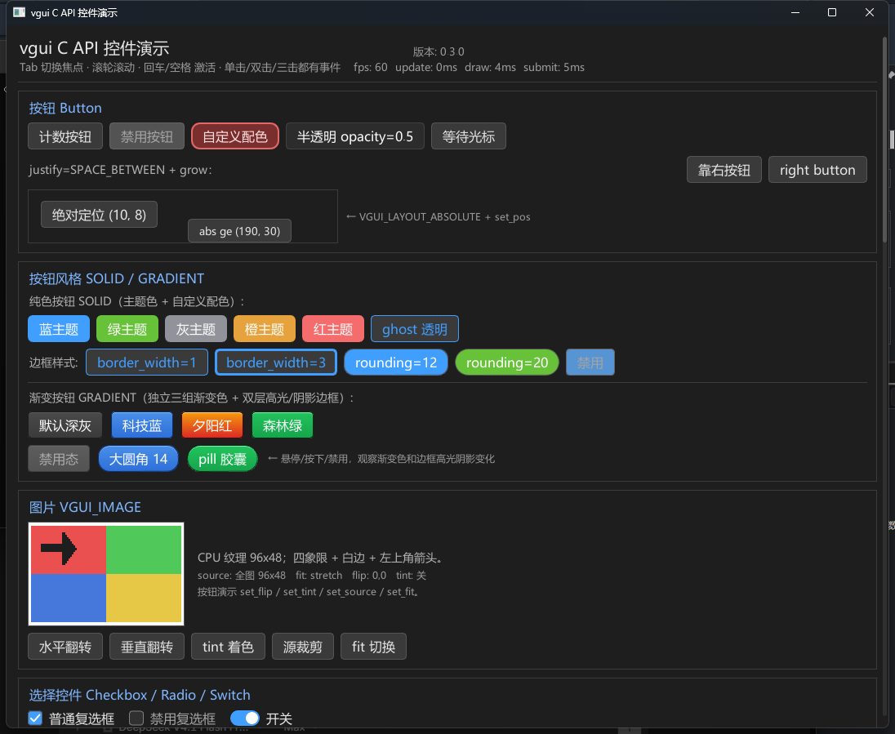

# vgui 保留模式（retained-mode）GUI 库

vgui 是一个基于 [OVG](https://github.com/huahua369/ovg) 矢量渲染器的轻量级 **保留模式（retained-mode）GUI 库**。公共接口为纯 C（C99/C11），实现使用 C++23；内置控件树、Flexbox 风格布局、事件分发、主题系统和滚动面板，并通过 SDL3 后端完成窗口、输入与 GPU 渲染。

UI 侧维护控件树、布局和交互状态；绘制时遍历控件树，将矩形、圆角、文字、裁剪等矢量命令录制到 OVG，再交由 SDL3 GPU 后端提交渲染。`vgui` 自带的后端只实现 2D 所需的路径、渐变、文本图集、图片、矩形裁剪和 MSAA，并使用 SPIR-V（Vulkan）着色器；OVG 自带的完整渲染器仍保留在 `third_party/ovg` 供其示例使用。

> 当前 API 版本（`vgui_version()`）：`0.3.0` · 许可证：MIT · 示例主要在 Windows + MSVC + SDL3 环境下验证。

## 特性

| 模块 | 能力 |
|---|---|
| **公共接口** | 纯 C 头文件 `vgui.h`，不依赖 C++ 类型、模板或 glm；可直接从 C/C++ 或其他语言通过 FFI 调用 |
| **控件** | Panel、Label、Button、Checkbox、Radio、Switch、Slider（水平/垂直）、Progress、Edit、Separator、List、Tree、Menu、MenuBar、Splitter、TabView、Dock |
| **覆盖层** | Tooltip、Modal（遮罩/焦点陷阱/背景隔离）、Alert/Confirm/Prompt 对话框、Toast 通知 |
| **编辑器组件** | IconButton、ToggleButton、SegmentedControl、Toolbar、StatusBar、SearchBox、Breadcrumb（`vgui_editor_kit`，基于公共 C API） |
| **布局** | 绝对定位、横向/纵向布局；padding、margin、gap、min/max size、align、justify、grow；滚动面板 |
| **事件** | 鼠标移动/按下/抬起/滚轮、单击/双击/三击、进入/离开、键盘、文本输入、IME、值改变、提交；列表/树/菜单事件携带稳定 item id 和索引 |
| **主题与样式** | `vgui_theme` 颜色主题 + `vgui_style` 控件尺寸/间距/圆角/动画参数，均支持运行时切换；控件级背景、边框、圆角、文字颜色、透明度、字体大小；焦点环透明度 |
| **文本** | HarfBuzz 驱动的文本测量与渲染，UTF-8 文本，多字体族回退，水平/垂直对齐 |
| **滚动** | 面板横向/纵向滚动；滚轮、拖动滚动条、点击轨道、程序化滚动；支持嵌套滚动面板 |
| **渲染** | 基于 OVG 的矢量路径、圆角矩形、文本和裁剪；SDL3 GPU 后端 |
| **工程** | CMake + vcpkg 清单，附带完整控件演示和无需窗口/GPU 的自测程序 |

### 控件一览

| 控件 | 主要能力 |
|---|---|
| `VGUI_PANEL` | 容器；横向/纵向/绝对布局、裁剪、滚动、动态增删子控件 |
| `VGUI_LABEL` | 文本显示、字号、颜色、水平/垂直对齐 |
| `VGUI_BUTTON` | 单击/双击/三击事件、禁用态、自定义背景/边框/圆角 |
| `VGUI_CHECKBOX` / `VGUI_SWITCH` | 布尔值、选中状态、值改变回调 |
| `VGUI_RADIO` | 同一父节点下的单选组自动互斥 |
| `VGUI_SLIDER` | 水平/垂直方向、范围、步长、拖动和方向键调节 |
| `VGUI_PROGRESS` | 范围与当前值显示，可用于静态或动画进度 |
| `VGUI_EDIT` | 单行/多行文本编辑，详见下文 |
| `VGUI_SEPARATOR` | 分隔线 |
| `VGUI_LIST` | 数据模型列表；稳定 `vgui_item_id`、单选/多选、键盘导航、滚轮与滚动条 |
| `VGUI_TREE` | 数据模型树；展开/折叠、层级选择、键盘导航、可见行扁平化 |
| `VGUI_MENU` | 上下文菜单浮层；复选项、子菜单、快捷键文本、禁用项；打开时消费外部点击 |
| `VGUI_MENUBAR` | 菜单标题条；点击/悬停/方向键切换菜单，管理所属弹层的生命周期 |
| `VGUI_SPLITTER` | 双子面板分栏；水平/垂直、嵌套、比例、sash、最小尺寸、拖动改变比例、双击复位 |
| `VGUI_TABVIEW` | 标签页容器；关闭回调、未保存标记、禁用页、拖拽重排、滚轮溢出、键盘切换/关闭 |
| `VGUI_DOCK` | 左右/底部/中央停靠区与浮动框架；标签组合并、拖动重排/跨区移动/浮出再停靠、关闭/恢复、区域尺寸、布局状态查询 |

### 文本编辑框

- 单行/多行编辑、占位符、密码掩码、只读模式。
- 鼠标拖拽选择、双击选词、三击选行；CJK 文本按词/字符边界处理。
- 复制、剪切、粘贴、撤销、重做；支持 `Ctrl+A/C/X/V/Z/Y`（`Ctrl+Shift+Z` 也可重做），并兼容 `Ctrl+Insert`、`Shift+Insert`、`Shift+Delete`。
- 键盘导航：方向键、Home/End、PageUp/PageDown、`Ctrl+左右` 按词移动、`Shift+方向键` 扩展选区。
- 多行编辑框内容滚动与内部滚动条，支持滚轮和拖动；内容宽度超出时自动显示水平滚动条。
- IME 组合文本显示、光标位置查询和输入框矩形上报。
- 文本光标宽度可配置，默认 1 像素；`vgui_edit_set_caret_width(edit, 2.0f)` 可加宽，设为 0 可隐藏。
- 选区高亮颜色与圆角可配置。多行选区按整体轮廓填充，共享边保持连续，所有外露拐角（包括行宽变化处的台阶/凹角）都会倒圆；`vgui_edit_set_selection_rounding(edit, 0)` 可关闭圆角。

### 列表、树与菜单

列表和树是**数据模型控件**：每一行是带稳定 `vgui_item_id` 的记录，而不是子控件；第一版只支持选择，不提供逐行复选框。两者复用面板的裁剪、滚动条和滚轮逻辑，并支持单选/多选、键盘导航、空状态文本和程序化滚动。

```c
vgui_widget* list = vgui_widget_add(root, VGUI_LIST, NULL);
vgui_item_id item = vgui_list_add_item(list, "打开文件", NULL);
vgui_list_set_item_detail(list, item, "Ctrl+O");
vgui_list_set_selection_mode(list, VGUI_SELECTION_SINGLE);
vgui_list_on_select(list, on_list_select, NULL);
vgui_list_on_activate(list, on_list_activate, NULL); /* 双击/回车 */

vgui_widget* tree = vgui_widget_add(root, VGUI_TREE, NULL);
vgui_item_id dir = vgui_tree_add_node(tree, 0, "src", NULL);
vgui_tree_add_node(tree, dir, "main.cpp", NULL);
vgui_tree_set_item_expanded(tree, dir, 1);
```

选择回调签名为 `vgui_item_select_fn(widget, item, selected, user)`；激活回调为 `vgui_item_fn(widget, item, user)`。普通事件中的 `vgui_event.item` 和 `vgui_event.index` 也会填入对应的模型项与索引。

菜单是上下文级浮层，不挂到布局子控件中；一个 `vgui_context` 同时只保留一条打开的菜单链。菜单项同样是模型记录，支持普通项、复选项、分隔线、禁用项和子菜单。点击菜单外部会关闭菜单并消费该次鼠标按下/抬起，不会穿透到下面的控件。

```c
vgui_widget* menu = vgui_widget_create(ui, VGUI_MENU, NULL);
vgui_menu_add_check_item(menu, "自动保存", 1);
vgui_item_id open = vgui_menu_add_item(menu, "打开设置");
vgui_menu_set_item_shortcut(menu, open, "Ctrl+,");
vgui_menu_add_separator(menu);

vgui_widget* more = NULL;
vgui_menu_add_submenu(menu, "更多", &more);
vgui_menu_add_item(more, "关于 vgui");

vgui_menu_on_activate(menu, on_menu_activate, NULL);
vgui_menu_open_below(menu, button);
```

打开菜单时 `vgui_context_wants_mouse()` / `vgui_context_wants_keyboard()` 返回 1，`vgui_context_wants_text_input()` 返回 0；Esc 关闭当前子菜单，重复按 Esc 关闭整条链。当前版本不绘制菜单图标。

### MenuBar 与命令/快捷键

`VGUI_MENUBAR` 是布局内的菜单标题条，每个标题拥有一个 `VGUI_MENU` 弹层。点击标题打开菜单；菜单打开时悬停其他标题会直接切换，左右方向键也可切换。`vgui_menubar_add_menu()` 把已有菜单交给 bar 管理，删除标题或销毁 bar 会一并销毁弹层。

```c
vgui_widget* bar = vgui_widget_add(root, VGUI_MENUBAR, NULL);
vgui_widget* file = vgui_widget_create(ui, VGUI_MENU, NULL);
vgui_menu_add_item(file, "保存");
vgui_menubar_add_menu(bar, "文件", file);
```

应用级快捷键通过 `vgui_context_add_key_handler()` 注册：处理器在焦点控件和打开菜单之后按注册逆序调用，返回非零表示已消费。editor kit 在此基础上提供 `command_registry`（字符串命令 ID、`Ctrl+S` / `Delete` 形式的快捷键、enabled/checked 谓词、菜单与工具栏状态同步）；`editor_shell` 默认建立 File/Edit/View/Help 菜单，宿主可用相同 ID 覆盖默认动作。

### Tooltip

Tooltip 是 context 级覆盖层，不参与布局和命中测试。控件可设置静态文本或动态 provider；默认延迟出现并跟随鼠标，也可锚定到控件下方，空间不足时自动翻转到上方。列表/树支持逐行 tooltip。

```c
vgui_widget_set_tooltip(button, "保存当前文档");
vgui_widget_set_tooltip_provider(status, status_tooltip, app);
vgui_widget_set_tooltip_delay(button, 0.4f);
vgui_widget_set_tooltip_anchor(button, VGUI_TOOLTIP_ANCHOR_WIDGET);
vgui_list_set_item_tooltip(list, item, "双击打开");
```

`vgui_widget_set_tooltip_enabled()` 可整体关闭某个控件的 tooltip，`vgui_widget_set_tooltip_when_disabled()` 控制禁用态是否显示。运行中的 tooltip 可通过 `vgui_context_tooltip_visible/text/owner/rect()` 查询，`vgui_context_hide_tooltip()` 立即隐藏；打开菜单/模态、滚动或销毁 owner 时也会自动隐藏。

### Modal、Dialog 与 Toast

`vgui_modal_show()` 把任意 panel 提升为 context 级模态：创建全窗口 stage、居中 panel，并把命中测试、焦点、Tab 循环和滚轮限制在模态内。`vgui_modal_options` 控制 Esc/背景点击关闭、遮罩透明度、是否销毁 panel 和关闭回调；关闭后焦点恢复到打开前的控件。

```c
vgui_modal_options options;
vgui_modal_options_default(&options);
options.on_close = on_modal_closed;
vgui_modal_show(ui, panel, &options);
```

常用对话框可直接调用 `vgui_dialog_alert()`、`vgui_dialog_confirm()` 和 `vgui_dialog_prompt()`。它们自动管理 panel 生命周期，确认/取消通过 `vgui_dialog_close_fn` 返回，prompt 还会返回输入文本；Enter 确认、Esc 取消，危险确认使用主题的危险色。`vgui_dialog_input()` 可在 prompt 打开时取得编辑框。

Toast 是另一类 context 覆盖层，不参与布局或命中测试：

```c
vgui_toast_options toast;
vgui_toast_options_default(&toast);
toast.position = VGUI_TOAST_BOTTOM_RIGHT;
toast.level = VGUI_TOAST_SUCCESS;
vgui_toast_id id = vgui_toast_show(ui, "已保存", &toast);
```

`duration < 0` 使用 `style.toast.duration`，`0` 表示常驻；`vgui_update()` 负责倒计时。`vgui_toast_dismiss()`、`vgui_toast_clear()`、`vgui_toast_count()` 和 `vgui_toast_get_rect()` 用于管理或查询通知。

### Splitter 与 TabView

`VGUI_SPLITTER` 是双子面板容器：`vertical=0` 左右分栏，`vertical=1` 上下分栏。`ratio` 表示第一个可见子面板在主轴上所占比例，拖动 sash 修改比例，双击 sash 复位；子面板的 `min_w` / `min_h` 会约束最终尺寸。`vgui_widget_on_value()` 可监听拖动后的比例变化。

```c
vgui_widget* splitter = vgui_widget_add(root, VGUI_SPLITTER, NULL);
vgui_splitter_set_vertical(splitter, 0);
vgui_splitter_set_ratio(splitter, 0.25f);
vgui_widget_add(splitter, VGUI_PANEL, NULL);
vgui_widget_add(splitter, VGUI_PANEL, NULL);

vgui_widget* tabs = vgui_widget_add(root, VGUI_TABVIEW, NULL);
vgui_widget* page = vgui_widget_create(ui, VGUI_PANEL, NULL);
vgui_item_id doc = vgui_tab_add(tabs, "Scene", page);
vgui_tab_set_unsaved(tabs, doc, 1);
vgui_tab_on_close(tabs, on_tab_close, NULL);
```

TabView 负责页面可见性和生命周期：`vgui_tab_add()` 接管页面，移除标签会销毁页面。设置 `vgui_tab_on_close()` 后由宿主决定是否调用 `vgui_tab_remove()`（便于未保存确认）；未设置回调时可直接关闭。标签支持禁用、未保存标记、关闭按钮、鼠标拖拽重排、滚轮横向溢出和键盘切换/关闭（`Ctrl+W`），右键会发送带 `item` 的鼠标事件供宿主打开菜单。

### Dock 与浮动面板

`VGUI_DOCK` 把面板组织为四个停靠区（左、右、底部、中央）和若干浮动框架。每个停靠区是一个标签组，只布局当前活动页；区域没有打开的面板时自动折叠，中央区占据剩余空间。`vgui_dock_add()` 接管页面所有权，`vgui_dock_remove()` / `vgui_dock_clear()` 销毁页面，`vgui_dock_detach()` 则把页面交还给调用方。

```c
vgui_widget* dock = vgui_widget_add(root, VGUI_DOCK, NULL);

vgui_dock_panel_desc desc;
vgui_dock_panel_desc_default(&desc);
desc.id = "outliner";              /* 可选稳定字符串 id，便于保存/恢复 */
desc.title = "Outliner";
desc.panel = vgui_widget_create(ui, VGUI_PANEL, NULL);
desc.zone = VGUI_DOCK_LEFT;
vgui_item_id panel = vgui_dock_add(dock, &desc);

vgui_dock_set_zone_size(dock, VGUI_DOCK_LEFT, 260.0f);
vgui_dock_float(dock, panel, 120.0f, 120.0f, 360.0f, 260.0f);
vgui_dock_on_close(dock, on_dock_close, app);
```

- 拖动标签可重排或移到其他区域；拖出停靠区会变成浮动框架，拖到区域标签条则重新停靠。拖动浮动框架标题可移动窗口，拖到标签条可停靠。
- `vgui_dock_close()` 只隐藏面板并保留区域/顺序，`vgui_dock_restore()` 重新打开并激活；关闭按钮可通过 `vgui_dock_set_closeable()` 控制。
- `vgui_dock_get_zone()/get_index()/is_open()/get_floating_rect()` 可读取布局状态，配合字符串 id 与 `vgui_dock_panel_desc` 重建即可恢复布局；区域尺寸通过 `vgui_dock_set_zone_size()` 保存/恢复。
- 标签条溢出时可用滚轮横向滚动；样式字段位于 `vgui_style.dock`，颜色位于 `vgui_theme.dock_*`，零值会回退到面板/按钮/菜单调色板。

### 编辑器布局持久化

`vgui_editor_kit::editor_shell` 使用一个 `VGUI_DOCK` 组织 Outliner / Viewport / Properties / Bottom 四个面板，稳定 id 分别为 `"outliner"`、`"viewport"`、`"properties"`、`"bottom"`。`dock()` 返回该 Dock，宿主可直接用 `vgui_dock_*` 调整停靠区、合并标签组或浮出面板；`bottom_tabs()` 仍返回底部的 ASSETS / CONSOLE TabView。旧的 `body_splitter()` / `workspace_splitter()` / `center_splitter()` 为源码兼容保留，但已不再创建 Splitter，统一返回 `nullptr`。

外壳布局记录为带版本号的 JSON（当前版本 2）：Dock 左/右/底部区域尺寸、每个区域的标签顺序、面板打开状态与活动页、浮动面板矩形，以及底部 Tab 顺序和当前页。布局文件与场景文档分离，可在退出时保存、启动时恢复；版本 1 的旧文件（仅 Splitter 比例、面板可见性和底部 Tab）仍可加载并映射到 Dock，文件损坏或版本不支持时回退到 `build()` 后的默认布局。

```cpp
vgui_editor_kit::editor_context context(ui);
vgui_editor_kit::editor_shell shell(context);
shell.build();

shell.load_layout("user/editor_layout.json");  // 失败时自动恢复默认布局
// ... 用户调整面板 ...
shell.save_layout("user/editor_layout.json");
```

也可以使用 `capture_layout()` / `apply_layout()` 在内存中交换布局，或调用 `reset_layout()` 恢复默认布局。

### 属性编辑（PropertyGrid）

`vgui_editor_kit::property_grid` 是类型化属性检查器：行按分类分组，可折叠、搜索过滤，包含标签列 + 编辑列、单行重置、只读状态、行级错误和 tooltip。行按滚动视口虚拟化：只创建可见窗口（含少量 overscan）内的行控件，其余行由上下 spacer 占位，因此上千行属性也能保持稳定的布局与滚动开销。`editor_shell` 的 Properties 面板和 `vgui_editor` 的 UI 文档检查器都已使用它。

```cpp
vgui_editor_kit::property_grid grid;
grid.build(parent);
grid.set_command_stack(&context.commands());

vgui_editor_kit::property_desc desc;
desc.id = "position.x";
desc.label = "X";
desc.type = vgui_editor_kit::property_type::number;
desc.value = "0.5";
desc.category = "Transform";
desc.has_range = true;
desc.min_value = -100.0;
desc.max_value = 100.0;
desc.step = 0.1;
desc.has_default = true;
desc.default_value = "0";
grid.add_property(desc);

grid.set_change_listener([](const std::string& id, const std::string& value) {
    // 同步宿主模型；undo/redo 也会再次触发
});
grid.commit_property_value("position.x", "1.25");
```

- 支持 `text`、`integer`、`number`、`boolean`、`enumeration`、`color` 六种类型。值统一使用规范字符串：整数为十进制，浮点为十进制或科学计数法，布尔为 `true`/`false`，枚举为 `choice_values` 中的值，颜色为 `#RRGGBB` 或 `#RRGGBBAA`。
- 数字类型可设置范围和步进，输入越界会被钳制；拖动标签可调值，按住 Shift 精调、Alt 粗调。枚举支持禁用项；颜色行带色块、预设和最近颜色。
- `commit_property_value()` / `reset_property()` 会校验并写回，触发 change listener，并在绑定命令栈时通过 `command_stack::push()` 记录可撤销命令。`set_property_value()` 只做显示/模型同步，不通知也不记录命令；提交失败时保留原值和输入文本，并显示行内错误，修正后可再次提交。
- `clear()` 重建行时保留搜索词、分类折叠状态和最近颜色；`set_filter()`、`set_category_collapsed()`、`set_read_only()` 可保持或批量调整视图状态。
- 行虚拟化由扁平化的“分类标题 + 属性行”显示列表驱动：滚动、过滤、折叠和增删行只重建该列表，并按视口窗口挂载/释放行控件。`materialized_row_count()` 返回当前实际创建的属性行数，可用于无窗口性能断言；未物化行的 `property_editor()` 返回 `nullptr`。
- 核心 `vgui_panel_set_scroll_listener()` 在程序化滚动、滚轮和滚动条拖动后通知监听器，PropertyGrid 用它驱动窗口更新；监听器内再次调整滚动位置是安全的，重入通知会被合并。
- `property_desc::get_value` / `set_value`，或 `set_value_source()` + `refresh()`，可把行绑定到宿主模型。
- `bind_selection()` 订阅 `editor_context` 的选择变化，在回调中按对象重建行；销毁 grid 前应调用 `unbind_selection()`（析构函数也会自动解绑）。PropertyGrid 必须早于 `vgui_context`、命令栈和 `editor_context` 销毁。

### 工具栏与状态栏组件（vgui_editor_kit）

S07 组件位于 `gui/editor/`，全部构建在公共 C API 之上：

- `icon_button`：包裹 `VGUI_BUTTON`，支持图标、tooltip、enabled 和 checked（激活态）。核心按钮会把 checked 绘制为激活底色。
- `toggle_button`：点击切换 checked，`set_on_change()` 报告新状态；程序化 `set_checked()` 不触发回调。
- `segmented_control`：互斥分段按钮。`select()` 拒绝禁用/越界项并通知，`set_selected()` 静默；`set_segment_enabled()` 可禁用单项。
- `toolbar_view`：横向工具栏，提供 `add_icon_button()`、`add_toggle_button()`、`add_segmented_control()`、`add_label()`、`add_spacer()`、`add_separator()`。`add_command_button(registry, "edit.undo")` 绑定命令，按钮文本、enabled/checked 随 `refresh_commands()` 与菜单同步，点击直接调用 `command_registry::invoke()`。
- `status_bar`：消息、选中对象、坐标、错误四个字段，可在 `build()` 前设置；`set_selected_object()` 格式化为 `Selected: <id>`，`set_coordinates()` 格式化坐标，`set_error()` / `clear_error()` 管理错误文本。
- `search_box`：`VGUI_EDIT` + 清除按钮。`set_on_change()` 在用户输入或清除时回调，`set_on_submit()` 在 Enter 或 `submit()` 时回调；`set_text()` 静默，`clear()` 模拟用户清除。
- `breadcrumb`：`breadcrumb_item{label, id}` 路径，最后一项为当前项。`navigate(index)` 触发回调，`set_items()` / `set_active()` 静默，避免宿主在刷新路径时重入导航逻辑。

```cpp
vgui_editor_kit::toolbar_view toolbar;
toolbar.build(parent);
toolbar.add_command_button(shell.commands(), "edit.undo");

vgui_editor_kit::status_bar status;
status.build(parent);
status.set_selected_object(42);
status.set_coordinates(1.25f, -2.5f);
status.set_error("asset missing");
```

组件不可拷贝（控件回调指回 C++ 对象），必须比其控件树存活更久；`toolbar_view` 绑定的 `command_registry` 也必须比工具栏存活更久。`editor_shell` 已使用这些组件：顶部工具栏包含标题、场景搜索、Undo/Redo 命令按钮、Grid 开关和 Persp/Top/Front 分段控件；底部状态栏显示 `set_status()` 消息和当前选择；Properties 面板顶部显示 `Scene / Object <id>` 面包屑。

### 交互与焦点

- Tab / Shift+Tab 切换焦点，鼠标点击自动聚焦，可设置 `focusable`。
- 悬停、按下、选中等状态动画；可设置鼠标指针形状和禁用态。
- 命中测试、嵌套控件事件分发，输入函数会返回事件是否被消费。

## 快速开始

### 环境要求

- CMake 3.21+（项目最低要求 3.16，仓库中的 `CMakePresets.json` 需要 3.21+）
- C++23 编译器（MSVC 2022 或更新版本）
- vcpkg（推荐），仓库已包含 `vcpkg.json`
- 主要依赖：SDL3、HarfBuzz、Fontconfig、glm、zlib、Clipper2、EnTT（示例使用）
- OVG 以 git submodule 形式放在 `third_party/ovg`

### 构建

```bash
git clone --recursive https://github.com/huahua369/vgui.git
cd vgui

# 在 Visual Studio 开发者命令行中运行；需要 vcpkg 依赖可用
cmake --preset x64-debug
cmake --build out/build/x64-debug
```

如果克隆时没有带上子模块，执行 `git submodule update --init --recursive`。

如果 CMake 找不到 vcpkg 依赖，可显式指定工具链：

```bash
cmake --preset x64-debug -DCMAKE_TOOLCHAIN_FILE=<vcpkg>/scripts/buildsystems/vcpkg.cmake
cmake --build out/build/x64-debug
```

发布构建使用 `x64-release`。`CMakePresets.json` 中另有 Linux/macOS 的配置骨架；跨平台构建需自行适配系统依赖和示例代码。

### 运行示例

Debug 输出目录为 `out/bin/x64d/`：

```text
out/bin/x64d/vgui_demo.exe             # 全部控件的交互演示
out/bin/x64d/vgui_edit_test.exe        # 编辑框、滚动、主题、焦点等无需窗口/GPU 的行为自测
out/bin/x64d/vgui_model_test.exe       # 列表、树、菜单、Tooltip/Modal/Dialog/Toast 与输入行为自测
out/bin/x64d/vgui_editor_kit_test.exe  # editor kit 骨架、Dock 外壳、类型化属性、命令栈与布局持久化自测
out/bin/x64d/vgui.exe                  # OVG 场景示例
```

`vgui_demo` 中可以体验按钮、选择控件、滑杆、进度条、编辑框、列表、树、菜单、滚动面板、动态增删控件、主题切换、焦点透明度和选区圆角等功能。

## 最小示例

假设 `ui` 已经通过 `vgui_create(font, 16.0f)` 创建：

```c
#include "vgui.h"

static void on_click(vgui_widget* widget, const vgui_event* event, void* user)
{
    (void)widget;
    (void)user;
    if (event->type == VGUI_EVENT_CLICK)
    {
        /* 处理点击 */
    }
}

void build_ui(vgui_context* ui)
{
    vgui_context_set_size(ui, 800, 600);

    /* 先取默认样式，只改需要调整的字段；未修改的字段保持当前外观。 */
    vgui_style style;
    vgui_style_default(&style);
    style.button.rounding = 8.0f;
    style.button.padding_x = 16.0f;
    style.edit.scrollbar_width = 6.0f;
    style.animation_speed = 12.0f;          /* 0 = 关闭悬停/勾选动画 */
    vgui_context_set_style(ui, &style);

    vgui_widget* root = vgui_root(ui);
    vgui_widget_set_layout(root, VGUI_LAYOUT_COLUMN);
    vgui_widget_set_padding(root, 16, 16, 16, 16);
    vgui_widget_set_gap(root, 8);

    vgui_widget_add(root, VGUI_LABEL, "Hello vgui");

    vgui_widget* button = vgui_widget_add(root, VGUI_BUTTON, "Click me");
    vgui_widget_on_event(button, on_click, NULL);

    vgui_widget* edit = vgui_widget_add(root, VGUI_EDIT, "");
    vgui_edit_set_multiline(edit, 1);
    vgui_edit_set_text(edit, "第一行\n第二行");
    vgui_edit_set_caret_width(edit, 2.0f);       /* 默认 1 像素，0 = 隐藏 */
    vgui_edit_set_selection_rounding(edit, 4.0f); /* 0 = 方角，>0 = 圆角半径 */
}
```

每帧更新和绘制：

```c
vgui_update(ui, delta_time);
vgui_draw(ui, ovg_cb, rvg);
```

字体、OVG 回调和 SDL3 窗口的初始化由后端/宿主程序负责，完整流程见 `sample/vgui_demo.cpp`。颜色格式统一为 `0xAARRGGBB`。

`vgui_style` 覆盖面板、标签、按钮、复选框、单选、开关、滑杆、进度条、编辑框、列表、树、菜单、工具栏、Tooltip、模态、Toast、Dock、焦点环、滚动条和动画参数；`vgui_context_set_style()` 会同步迁移仍在使用旧默认值的已有控件，控件级显式设置保持不变。`vgui_theme` 除基础调色板外还包含列表/树/菜单、Tooltip、模态/Toast 以及 Dock 使用的颜色字段（`modal_backdrop`、`modal_bg`、`modal_border`、`modal_danger`、`toast_bg`、`toast_border`、`toast_text`、`toast_info`、`toast_success`、`toast_warning`、`toast_error`、`dock_bg`、`dock_border`、`dock_tab_bg`、`dock_tab_active`、`dock_tab_text`、`dock_floating_bg`、`dock_floating_border`、`dock_floating_title` 等）；旧主题把这些字段留为 0 时会自动回退到面板/文字/菜单/强调色，不会破坏现有主题。列表/树的自动行高和菜单的自动最大高度也可以通过样式字段设为 0 来保持自动计算。

## 项目结构

```text
gui/
  vgui.h              公共纯 C API
  vgui.cpp            控件树、布局、事件与绘制实现（含 MenuBar/Splitter/TabView/Dock/Tooltip/Modal/Toast）
  vgui_internal.h     内部 C++ 接口（兼容旧版）
  vgui_legacy.cpp     旧版 C++ 接口适配
  editor/             vgui_editor_kit 编辑器组件层（MVP 骨架，含菜单/命令与布局持久化）
backends/
  vgui_sdl3.*          SDL3 窗口、输入、IME 与 GPU 视口
  vgui_renderer_sdl3.* vgui 专用 SDL3 GPU 2D 矢量后端
  mapView.*           视图/地图相关后端组件
third_party/
  ovg/                OVG 矢量渲染器（git submodule）
sample/
  vgui_demo.cpp             全部控件的交互演示
  vgui_edit_test.cpp        编辑框、滚动、主题、焦点自测
  vgui_model_test.cpp       列表、树、菜单、MenuBar、Dock、Tooltip、Modal/Dialog/Toast 与按键处理器自测
  vgui_editor_kit_test.cpp  editor kit 骨架、Dock 外壳、类型化属性、命令栈、菜单/快捷键与布局持久化自测
  main.cpp                  OVG 场景示例
docs/
  phase0_3d_editor.md 3D 场景编辑器基础与图片/纹理能力
  editor_roadmap.md   游戏编辑器组件路线图
```

公共 API 和控件相关说明集中在 `gui/vgui.h`；内部 C++ 声明在 `gui/vgui_internal.h`。

## 路线图

游戏编辑器方向的组件分层、优先级、依赖和验收标准见 [`docs/editor_roadmap.md`](docs/editor_roadmap.md)。Phase 0 的图片/原生纹理基础见 [`docs/phase0_3d_editor.md`](docs/phase0_3d_editor.md)。

## 测试

```bash
out/bin/x64d/vgui_edit_test.exe
out/bin/x64d/vgui_model_test.exe
out/bin/x64d/vgui_editor_kit_test.exe
```

自测覆盖编辑框文本输入、选区、剪贴板、撤销/重做、多行滚动、内部滚动条拖动、面板滚动条、主题切换内容尺寸稳定性、焦点透明度等行为；模型测试覆盖列表/树的稳定 id、插入删除、单选/多选、展开折叠、键盘导航、菜单项激活/复选/子菜单、外部点击消费、MenuBar 标题切换与弹层生命周期、按键过滤器的注册顺序与消费，以及 Splitter 的比例/最小尺寸/拖动/复位和 TabView 的切换/关闭/禁用/重排/溢出/键盘操作；面板滚动监听覆盖程序化滚动、`scroll_by`、滚轮与移除回调。覆盖层测试还覆盖 Tooltip 的延迟/锚定/边缘翻转/销毁清理，Modal 的焦点陷阱/背景输入隔离/Esc/背景点击/销毁与焦点恢复，Alert/Confirm/Prompt 的结果与输入文本，以及 Toast 的位置/堆叠/过期/常驻/最大可见数/主题回退。Dock 测试覆盖四个停靠区/区域折叠、标签组与激活、关闭/恢复、跨区移动、标签重排、浮出/夹取/居中/提升/拖动/再停靠、空区落点推断、标签条滚轮滚动、detach/remove/clear、布局状态重建和样式/主题回退。`vgui_editor_kit_test` 覆盖 editor kit 的 Dock 外壳（四个稳定面板 id、区域合并、浮出、关闭与区域尺寸）、EditorContext 选择与可移除的选择监听器、Outliner/PropertyGrid/AssetBrowser 占位组件、Viewport 图片边界、命令栈的 undo/redo/事务/回滚与已应用命令 push、命令注册/快捷键分发/菜单状态同步，以及布局 JSON 的保存/恢复（Dock 区域尺寸、区域标签顺序、活动页、浮动矩形、底部 Tab 顺序与当前页）、版本 1 兼容映射、损坏和版本不匹配回退。PropertyGrid 测试覆盖文本/整数/浮点/布尔/枚举/颜色行、范围钳制与非法输入、默认值重置、只读状态、搜索过滤、分类折叠、值源刷新、get/set 描述符、命令栈撤销/重做、重建后的陈旧命令隔离，以及基于 editor_context 的选择绑定；1000 行虚拟化测试断言物化窗口有界、滚动到底部后顶部行被释放、滚回顶部后重新物化。`vgui_editor --selftest` 还覆盖 UI 文档编辑器切换到 PropertyGrid 后的属性行构建、JSON 往返与代码生成。失败时返回非零退出码，适合接入 CI。

## 第三方与许可证

- 项目本体使用 MIT License，详见 [`LICENSE.txt`](LICENSE.txt)。
- 矢量渲染器 OVG 位于 `third_party/ovg`，遵循其仓库中的许可证。
- 完整依赖清单见 [`vcpkg.json`](vcpkg.json)。

## 链接

- 仓库：<https://github.com/huahua369/vgui>
- OVG：<https://github.com/huahua369/ovg>
