# vgui 保留模式（retained-mode）GUI 库

vgui 是一个基于 [OVG](https://github.com/huahua369/ovg) 矢量渲染器的轻量级 **保留模式（retained-mode）GUI 库**。公共接口为纯 C（C99/C11），实现使用 C++23；内置控件树、Flexbox 风格布局、事件分发、主题系统和滚动面板，并通过 SDL3 后端完成窗口、输入与 GPU 渲染。

UI 侧维护控件树、布局和交互状态；绘制时遍历控件树，将矩形、圆角、文字、裁剪等矢量命令录制到 OVG，再交由 SDL3 GPU 后端提交渲染。`vgui` 自带的后端只实现 2D 所需的路径、渐变、文本图集、图片、矩形裁剪和 MSAA，并使用 SPIR-V（Vulkan）着色器；OVG 自带的完整渲染器仍保留在 `third_party/ovg` 供其示例使用。

> 当前 API 版本（`vgui_version()`）：`0.3.0` · 许可证：MIT · 示例主要在 Windows + MSVC + SDL3 环境下验证。

## 特性

| 模块 | 能力 |
|---|---|
| **公共接口** | 纯 C 头文件 `<vgui/vgui.h>`（兼容旧路径 `<vgui.h>`），不依赖 C++ 类型、模板或 glm；可直接从 C/C++ 或其他语言通过 FFI 调用 |
| **控件** | Panel、Label、Button、Checkbox、Radio、Switch、Slider（水平/垂直）、Progress、Edit、Separator、List、Tree、Menu、MenuBar、Splitter、TabView、Dock |
| **覆盖层** | Tooltip、Modal（遮罩/焦点陷阱/背景隔离）、Alert/Confirm/Prompt 对话框、Toast 通知 |
| **编辑器组件** | IconButton、ToggleButton、SegmentedControl、Toolbar、StatusBar、SearchBox、Breadcrumb、Spinbox、ComboBox、VectorEditor、ColorPicker、CurveEditor、GradientEditor、ThumbnailCache、ConsoleView、CanvasView、TableView、TimelineView、NodeGraphView（`vgui_editor_kit`，基于公共 C API） |
| **3D 视口示例** | `phase0_renderer` 多相机 view 共享着色器/管线/网格缓冲；HDR（RGBA16F + tonemap）、MSAA resolve、深度可视化纹理，可运行时切换 |
| **布局** | 绝对定位、横向/纵向布局；padding、margin、gap、min/max size、align、justify、grow；滚动面板 |
| **事件** | 鼠标移动/按下/抬起/滚轮、单击/双击/三击、进入/离开、键盘、文本输入、IME、值改变、提交；列表/树/菜单事件携带稳定 item id 和索引 |
| **主题与样式** | `vgui_theme` 颜色主题 + `vgui_style` 控件尺寸/间距/圆角/动画参数，均支持运行时切换；控件级背景、边框、圆角、文字颜色、透明度、字体大小；焦点环透明度 |
| **高 DPI** | 统一 `ui_scale` 同步缩放字体、间距、圆角与图标；逻辑 setter + 有效像素 getter；缩放监听器；SDL3 显示器切换自动同步；布局持久化保存逻辑尺寸 |
| **增量更新** | PropertyGrid 按 id+type 复用属性行，切换同 schema 对象不重建控件；Outliner 虚拟行源用 `scene_changed()`/`scene_row_changed()` 区分结构与单行刷新；AssetBrowser 只请求可见范围缩略图并复用内存/磁盘缓存 |
| **国际化** | UTF-8 文案表与运行时语言切换；RTL 布局/文本/常用控件镜像；OVG 多字体回退与 bidi 文本 |
| **无障碍** | 语义角色/名称/值/状态查询与可见控件树的预序遍历，供宿主桥接 UIA/AT-SPI/AccessKit；焦点陷阱、Tab 循环、F6 面板切换、F10 菜单、焦点/值/状态/选中/公告事件；高对比度主题 |
| **视觉回归** | 10 个编辑器关键状态离屏截图基线（Dock/PropertyGrid/Outliner/AssetBrowser/Viewport），容差对比并输出差异图；CTest 可直接运行，无 Vulkan 自动 SKIP |
| **文本** | HarfBuzz 驱动的文本测量与渲染，UTF-8 文本，多字体族回退，水平/垂直对齐 |
| **滚动** | 面板横向/纵向滚动；滚轮、拖动滚动条、点击轨道、程序化滚动；支持嵌套滚动面板 |
| **渲染** | 基于 OVG 的矢量路径、圆角矩形、文本和裁剪；SDL3 GPU 后端 |
| **工程** | CMake + vcpkg 清单，可安装的 CMake 包（`vgui::vgui` / `vgui::editor_kit` / `vgui::ovg`），附带控件演示、游戏编辑器示例、无需窗口/GPU 的模型自测与离屏截图回归（CTest） |

### 界面截图

以下截图由 `vgui_screenshot_test` 离屏渲染生成，同时作为 E03 视觉回归基线保存在 `sample/screenshots/`。

| | |
|---|---|
| 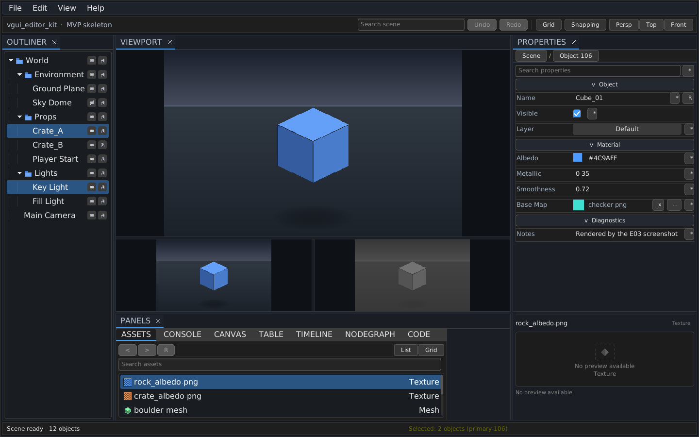<br>默认停靠布局：Outliner、Viewport、Properties 与多标签 Panels | 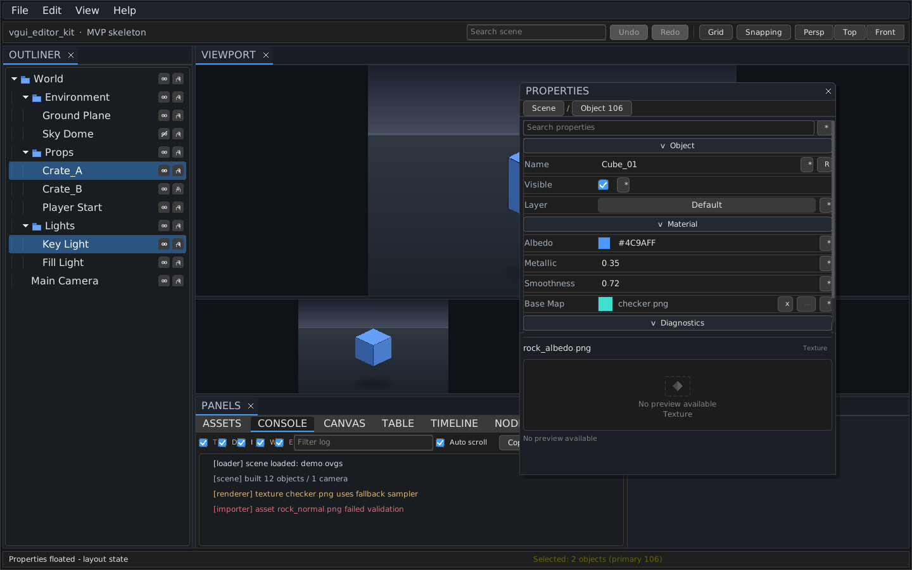<br>Properties 浮出为浮动面板，Console 日志位于 Panels 标签组 |
| 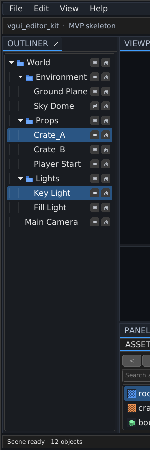<br>Dock 面板局部裁剪 | 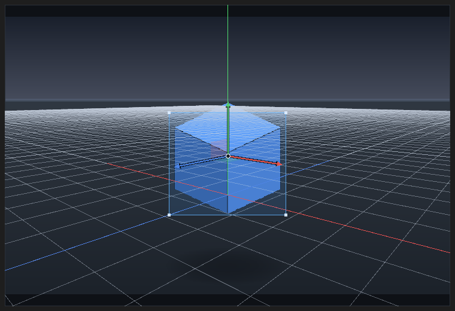<br>世界网格、选中包围盒与三轴平移 Gizmo |
| 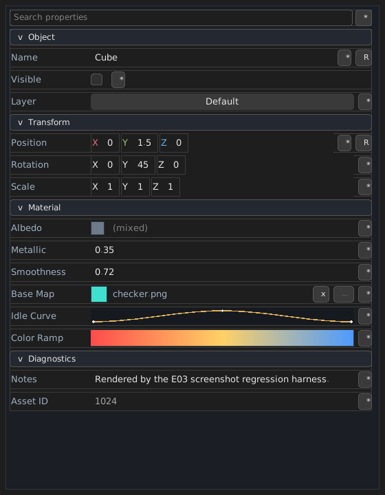<br>属性网格：向量分量、引用行、曲线与渐变编辑器 | 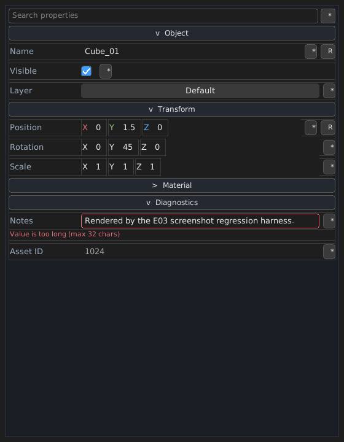<br>属性网格：多选混合值、校验提示与重置按钮 |
| 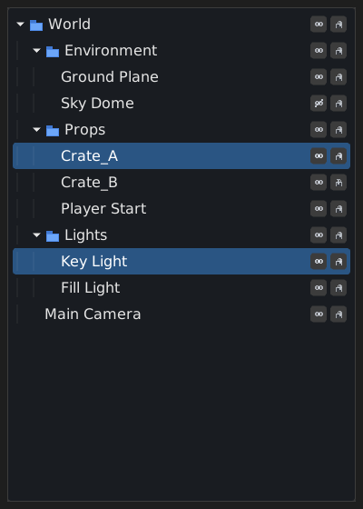<br>Outliner 多选高亮 | 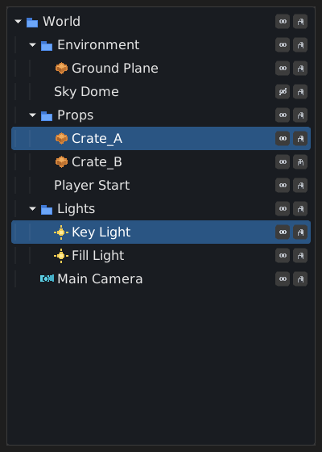<br>Outliner 虚拟行源与类型图标 |
| 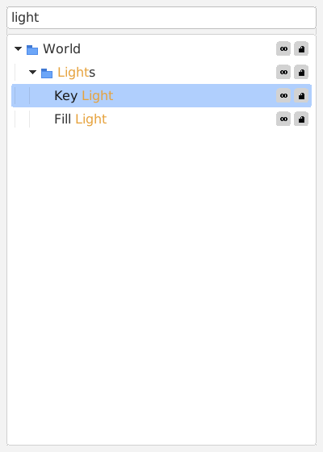<br>Outliner 关键词过滤（浅色主题） | 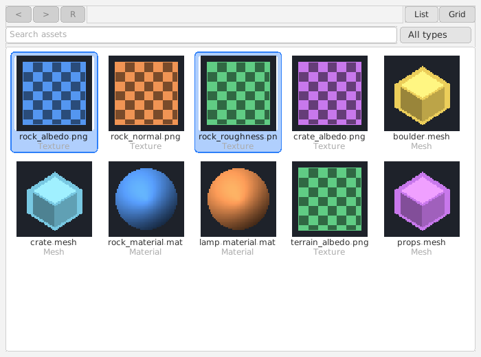<br>资产浏览器网格视图与缩略图 |
| 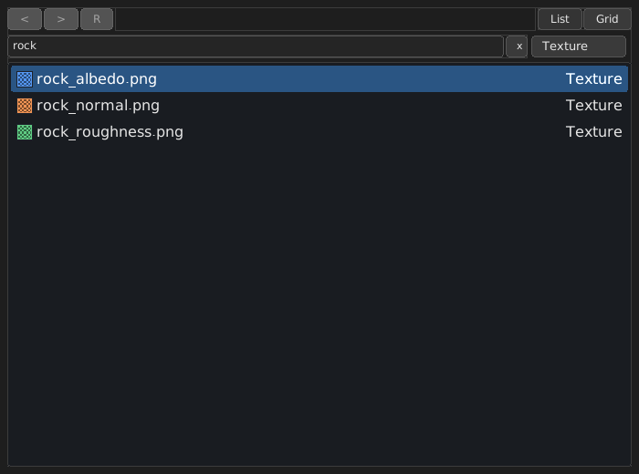<br>资产浏览器列表视图与搜索 | |

### 控件一览

| 控件 | 主要能力 |
|---|---|
| `VGUI_PANEL` | 容器；横向/纵向/绝对布局、裁剪、滚动、动态增删子控件 |
| `VGUI_LABEL` | 文本显示、字号、颜色、水平/垂直对齐 |
| `VGUI_BUTTON` | 单击/双击/三击事件、禁用态、自定义背景/边框/圆角 |
| `VGUI_CHECKBOX` / `VGUI_SWITCH` | 布尔值、选中状态、值改变回调 |
| `VGUI_RADIO` | 同一父节点下的单选组自动互斥 |
| `VGUI_SLIDER` | 水平/垂直方向、范围、步长、拖动和方向键调节 |
| `VGUI_PROGRESS` | 范围与当前值显示，可用于静态或动画进度 |
| `VGUI_EDIT` | 单行/多行文本编辑，详见下文 |
| `VGUI_SEPARATOR` | 分隔线 |
| `VGUI_LIST` | 数据模型列表；稳定 `vgui_item_id`、单选/多选、键盘导航、滚轮与滚动条 |
| `VGUI_TREE` | 数据模型树；展开/折叠、层级选择、键盘导航、可见行扁平化 |
| `VGUI_MENU` | 上下文菜单浮层；复选项、子菜单、快捷键文本、禁用项；打开时消费外部点击 |
| `VGUI_MENUBAR` | 菜单标题条；点击/悬停/方向键切换菜单，管理所属弹层的生命周期 |
| `VGUI_SPLITTER` | 双子面板分栏；水平/垂直、嵌套、比例、sash、最小尺寸、拖动改变比例、双击复位 |
| `VGUI_TABVIEW` | 标签页容器；关闭回调、未保存标记、禁用页、拖拽重排、滚轮溢出、键盘切换/关闭 |
| `VGUI_DOCK` | 左右/底部/中央停靠区与浮动框架；标签组合并、拖动重排/跨区移动/浮出再停靠、关闭/恢复、区域尺寸、布局状态查询 |
| `VGUI_IMAGE` | 纹理显示；source/fit/tint/flip/pixel snap，以及九宫格、旋转、任意 2D 矩阵（V10） |

### 图片与纹理变换

`VGUI_IMAGE` 同时支持 CPU 纹理（`vgui_texture_create`）和原生 GPU 纹理（`vgui_sdl3_texture_create_native`）。基础能力：

- `vgui_image_set_texture`：绑定纹理，`NULL` 清空。
- `vgui_image_set_source`：源像素区域，宽/高 `<= 0` 表示整张纹理。
- `vgui_image_set_fit`：`STRETCH` / `CONTAIN` / `COVER` / `NONE`。
- `vgui_image_set_tint`：`0xAARRGGBB` 颜色，乘到采样结果。
- `vgui_image_set_flip`：水平/垂直翻转。
- `vgui_image_set_pixel_snap`：目标矩形按像素对齐。

V10 增加九宫格、旋转和任意矩阵：

```c
/* 九宫格：纹理像素边宽；全 0 关闭。 */
vgui_image_set_nine_slice(image, 16, 16, 16, 16);

/* 旋转：角度，正值在屏幕上顺时针；默认绕目标矩形中心。 */
vgui_image_set_rotation(image, 30.0f);

/* 自定义旋转中心：相对目标矩形左上角；enabled=0 恢复目标中心。 */
vgui_image_set_rotation_center(image, 8.0f, 8.0f, 1);

/* 任意 2D 仿射矩阵，绕与旋转相同的枢轴；NULL 清除。 */
const float shear[6] = { 1.0f, 0.0f, 0.25f, 1.0f, 0.0f, 0.0f };
vgui_image_set_matrix(image, shear);
```

- 变换顺序固定为 **flip → rotation → matrix**，在 source 裁剪、fit 和 pixel snap 之后应用。
- 矩阵布局为 `{xx, yx, xy, yy, tx, ty}`：`x' = xx*x + xy*y + tx`，`y' = yx*x + yy*y + ty`。矩阵与旋转共享枢轴，因此自定义旋转中心也会移动矩阵原点。
- 九宫格边宽按纹理像素解释；源边宽超过源区域时收缩，目标矩形小于两侧边宽之和时按比例压缩。九宫格可与旋转/矩阵组合。
- 原生纹理走 OVG `add_texture`；CPU 纹理由 vgui 生成四边形/九宫格几何（`add_geometry`），两条路径的翻转、旋转、矩阵、tint 和裁剪结果一致。CPU 纹理首次绘制即可在同一帧上传并显示。
- 图片始终被控件矩形裁剪；旋转/矩阵把内容移出控件时会被裁掉。

### 文本编辑框

- 单行/多行编辑、占位符、密码掩码、只读模式。
- 鼠标拖拽选择、双击选词、三击选行；CJK 文本按词/字符边界处理。
- 复制、剪切、粘贴、撤销、重做；支持 `Ctrl+A/C/X/V/Z/Y`（`Ctrl+Shift+Z` 也可重做），并兼容 `Ctrl+Insert`、`Shift+Insert`、`Shift+Delete`。
- 键盘导航：方向键、Home/End、PageUp/PageDown、`Ctrl+左右` 按词移动、`Shift+方向键` 扩展选区。
- 多行编辑框内容滚动与内部滚动条，支持滚轮和拖动；内容宽度超出时自动显示水平滚动条。
- IME 组合文本显示、光标位置查询和输入框矩形上报。
- 文本光标宽度可配置，默认 1 像素；`vgui_edit_set_caret_width(edit, 2.0f)` 可加宽，设为 0 可隐藏。
- 背景默认使用主题的 `edit_bg`；`vgui_edit_set_background_transparent(edit, 1)` 可关闭背景填充，让父面板透出，边框、文字、选区和焦点环仍正常绘制。
- 选区高亮颜色与圆角可配置。多行选区按整体轮廓填充，共享边保持连续，所有外露拐角（包括行宽变化处的台阶/凹角）都会倒圆；`vgui_edit_set_selection_rounding(edit, 0)` 可关闭圆角。

### 列表、树与菜单

列表和树是**数据模型控件**：每一行是带稳定 `vgui_item_id` 的记录，而不是子控件；第一版只支持选择，不提供逐行复选框。两者复用面板的裁剪、滚动条和滚轮逻辑，并支持单选/多选、键盘导航、空状态文本和程序化滚动。

```c
vgui_widget* list = vgui_widget_add(root, VGUI_LIST, NULL);
vgui_item_id item = vgui_list_add_item(list, "打开文件", NULL);
vgui_list_set_item_detail(list, item, "Ctrl+O");
vgui_list_set_selection_mode(list, VGUI_SELECTION_SINGLE);
vgui_list_on_select(list, on_list_select, NULL);
vgui_list_on_activate(list, on_list_activate, NULL); /* 双击/回车 */

vgui_widget* tree = vgui_widget_add(root, VGUI_TREE, NULL);
vgui_item_id dir = vgui_tree_add_node(tree, 0, "src", NULL);
vgui_tree_add_node(tree, dir, "main.cpp", NULL);
vgui_tree_set_item_expanded(tree, dir, 1);
```

选择回调签名为 `vgui_item_select_fn(widget, item, selected, user)`；激活回调为 `vgui_item_fn(widget, item, user)`。普通事件中的 `vgui_event.item` 和 `vgui_event.index` 也会填入对应的模型项与索引。

菜单是上下文级浮层，不挂到布局子控件中；一个 `vgui_context` 同时只保留一条打开的菜单链。菜单项同样是模型记录，支持普通项、复选项、分隔线、禁用项和子菜单。点击菜单外部会关闭菜单并消费该次鼠标按下/抬起，不会穿透到下面的控件。

```c
vgui_widget* menu = vgui_widget_create(ui, VGUI_MENU, NULL);
vgui_menu_add_check_item(menu, "自动保存", 1);
vgui_item_id open = vgui_menu_add_item(menu, "打开设置");
vgui_menu_set_item_shortcut(menu, open, "Ctrl+,");
vgui_menu_add_separator(menu);

vgui_widget* more = NULL;
vgui_menu_add_submenu(menu, "更多", &more);
vgui_menu_add_item(more, "关于 vgui");

vgui_menu_on_activate(menu, on_menu_activate, NULL);
vgui_menu_open_below(menu, button);
```

打开菜单时 `vgui_context_wants_mouse()` / `vgui_context_wants_keyboard()` 返回 1，`vgui_context_wants_text_input()` 返回 0；Esc 关闭当前子菜单，重复按 Esc 关闭整条链。当前版本不绘制菜单图标。

### MenuBar 与命令/快捷键

`VGUI_MENUBAR` 是布局内的菜单标题条，每个标题拥有一个 `VGUI_MENU` 弹层。点击标题打开菜单；菜单打开时悬停其他标题会直接切换，左右方向键也可切换。`vgui_menubar_add_menu()` 把已有菜单交给 bar 管理，删除标题或销毁 bar 会一并销毁弹层。

```c
vgui_widget* bar = vgui_widget_add(root, VGUI_MENUBAR, NULL);
vgui_widget* file = vgui_widget_create(ui, VGUI_MENU, NULL);
vgui_menu_add_item(file, "保存");
vgui_menubar_add_menu(bar, "文件", file);
```

应用级快捷键通过 `vgui_context_add_key_handler()` 注册：处理器在焦点控件和打开菜单之后按注册逆序调用，返回非零表示已消费。`F10` 打开第一个可见菜单栏的首个可用标题，再按一次关闭；`F1`～`F12` 均可作为快捷键名解析。editor kit 在此基础上提供 `command_registry`（字符串命令 ID、`Ctrl+S` / `Delete` 形式的快捷键、enabled/checked 谓词、菜单与工具栏状态同步）；`editor_shell` 默认建立 File/Edit/View/Help 菜单，宿主可用相同 ID 覆盖默认动作。编辑器外壳还提供 `F6` / `Shift+F6` 在 Outliner、Viewport、Properties、底部面板之间循环焦点，以及 `Ctrl+Shift+H` 高对比度开关（View 菜单同项）。

### Tooltip

Tooltip 是 context 级覆盖层，不参与布局和命中测试。控件可设置静态文本或动态 provider；默认延迟出现并跟随鼠标，也可锚定到控件下方，空间不足时自动翻转到上方。列表/树支持逐行 tooltip。

```c
vgui_widget_set_tooltip(button, "保存当前文档");
vgui_widget_set_tooltip_provider(status, status_tooltip, app);
vgui_widget_set_tooltip_delay(button, 0.4f);
vgui_widget_set_tooltip_anchor(button, VGUI_TOOLTIP_ANCHOR_WIDGET);
vgui_list_set_item_tooltip(list, item, "双击打开");
```

`vgui_widget_set_tooltip_enabled()` 可整体关闭某个控件的 tooltip，`vgui_widget_set_tooltip_when_disabled()` 控制禁用态是否显示。运行中的 tooltip 可通过 `vgui_context_tooltip_visible/text/owner/rect()` 查询，`vgui_context_hide_tooltip()` 立即隐藏；打开菜单/模态、滚动或销毁 owner 时也会自动隐藏。

### Modal、Dialog 与 Toast

`vgui_modal_show()` 把任意 panel 提升为 context 级模态：创建全窗口 stage、居中 panel，并把命中测试、焦点、Tab 循环和滚轮限制在模态内。`vgui_modal_options` 控制 Esc/背景点击关闭、遮罩透明度、是否销毁 panel 和关闭回调；关闭后焦点恢复到打开前的控件。

```c
vgui_modal_options options;
vgui_modal_options_default(&options);
options.on_close = on_modal_closed;
vgui_modal_show(ui, panel, &options);
```

常用对话框可直接调用 `vgui_dialog_alert()`、`vgui_dialog_confirm()` 和 `vgui_dialog_prompt()`。它们自动管理 panel 生命周期，确认/取消通过 `vgui_dialog_close_fn` 返回，prompt 还会返回输入文本；Enter 确认、Esc 取消，危险确认使用主题的危险色。`vgui_dialog_input()` 可在 prompt 打开时取得编辑框。

Toast 是另一类 context 覆盖层，不参与布局或命中测试：

```c
vgui_toast_options toast;
vgui_toast_options_default(&toast);
toast.position = VGUI_TOAST_BOTTOM_RIGHT;
toast.level = VGUI_TOAST_SUCCESS;
vgui_toast_id id = vgui_toast_show(ui, "已保存", &toast);
```

`duration < 0` 使用 `style.toast.duration`，`0` 表示常驻；`vgui_update()` 负责倒计时。`vgui_toast_dismiss()`、`vgui_toast_clear()`、`vgui_toast_count()` 和 `vgui_toast_get_rect()` 用于管理或查询通知。

### Splitter 与 TabView

`VGUI_SPLITTER` 是双子面板容器：`vertical=0` 左右分栏，`vertical=1` 上下分栏。`ratio` 表示第一个可见子面板在主轴上所占比例，拖动 sash 修改比例，双击 sash 复位；子面板的 `min_w` / `min_h` 会约束最终尺寸。`vgui_widget_on_value()` 可监听拖动后的比例变化。

```c
vgui_widget* splitter = vgui_widget_add(root, VGUI_SPLITTER, NULL);
vgui_splitter_set_vertical(splitter, 0);
vgui_splitter_set_ratio(splitter, 0.25f);
vgui_widget_add(splitter, VGUI_PANEL, NULL);
vgui_widget_add(splitter, VGUI_PANEL, NULL);

vgui_widget* tabs = vgui_widget_add(root, VGUI_TABVIEW, NULL);
vgui_widget* page = vgui_widget_create(ui, VGUI_PANEL, NULL);
vgui_item_id doc = vgui_tab_add(tabs, "Scene", page);
vgui_tab_set_unsaved(tabs, doc, 1);
vgui_tab_on_close(tabs, on_tab_close, NULL);
```

TabView 负责页面可见性和生命周期：`vgui_tab_add()` 接管页面，移除标签会销毁页面。设置 `vgui_tab_on_close()` 后由宿主决定是否调用 `vgui_tab_remove()`（便于未保存确认）；未设置回调时可直接关闭。标签支持禁用、未保存标记、关闭按钮、鼠标拖拽重排、滚轮横向溢出和键盘切换/关闭（`Ctrl+W`），右键会发送带 `item` 的鼠标事件供宿主打开菜单。

### Dock 与浮动面板

`VGUI_DOCK` 把面板组织为四个停靠区（左、右、底部、中央）和若干浮动框架。每个停靠区是一个标签组，只布局当前活动页；区域没有打开的面板时自动折叠，中央区占据剩余空间。`vgui_dock_add()` 接管页面所有权，`vgui_dock_remove()` / `vgui_dock_clear()` 销毁页面，`vgui_dock_detach()` 则把页面交还给调用方。

```c
vgui_widget* dock = vgui_widget_add(root, VGUI_DOCK, NULL);

vgui_dock_panel_desc desc;
vgui_dock_panel_desc_default(&desc);
desc.id = "outliner";              /* 可选稳定字符串 id，便于保存/恢复 */
desc.title = "Outliner";
desc.panel = vgui_widget_create(ui, VGUI_PANEL, NULL);
desc.zone = VGUI_DOCK_LEFT;
vgui_item_id panel = vgui_dock_add(dock, &desc);

vgui_dock_set_zone_size(dock, VGUI_DOCK_LEFT, 260.0f);
vgui_dock_float(dock, panel, 120.0f, 120.0f, 360.0f, 260.0f);
vgui_dock_on_close(dock, on_dock_close, app);
```

- 拖动标签可重排或移到其他区域；拖出停靠区会变成浮动框架，拖到区域标签条则重新停靠。拖动浮动框架标题可移动窗口，拖到标签条可停靠。
- `vgui_dock_close()` 只隐藏面板并保留区域/顺序，`vgui_dock_restore()` 重新打开并激活；关闭按钮可通过 `vgui_dock_set_closeable()` 控制。
- `vgui_dock_get_zone()/get_index()/is_open()/get_floating_rect()` 可读取布局状态，配合字符串 id 与 `vgui_dock_panel_desc` 重建即可恢复布局；区域尺寸通过 `vgui_dock_set_zone_size()` 保存/恢复。
- 标签条溢出时可用滚轮横向滚动；样式字段位于 `vgui_style.dock`，颜色位于 `vgui_theme.dock_*`，零值会回退到面板/按钮/菜单调色板。

### 编辑器布局持久化

`vgui_editor_kit::editor_shell` 使用一个 `VGUI_DOCK` 组织 Outliner / Viewport / Properties / Bottom 四个面板，稳定 id 分别为 `"outliner"`、`"viewport"`、`"properties"`、`"bottom"`。`dock()` 返回该 Dock，宿主可直接用 `vgui_dock_*` 调整停靠区、合并标签组或浮出面板；`bottom_tabs()` 仍返回底部的 ASSETS / CONSOLE / CANVAS / TABLE / TIMELINE / NODEGRAPH / CODE TabView。旧的 `body_splitter()` / `workspace_splitter()` / `center_splitter()` 为源码兼容保留，但已不再创建 Splitter，统一返回 `nullptr`。

外壳布局记录为带版本号的 JSON（当前版本 6）：Dock 左/右/底部区域尺寸、每个区域的标签顺序、面板打开状态与活动页、浮动面板矩形，以及底部 Tab 顺序和当前页；版本 3 额外保存 TABLE 的列宽与排序状态，版本 4 保存 TIMELINE 的视图范围、缩放、播放头、时长、帧率、吸附与循环状态，版本 5 保存 NODEGRAPH 的平移/缩放、网格/小地图/吸附设置与选中项，版本 6 保存 CODE 编辑器的语言、只读/行号、Tab 宽度、光标与滚动状态（均为不透明 JSON 字符串）。布局文件与场景文档分离，可在退出时保存、启动时恢复；版本 1～5 的旧文件仍可加载并映射到当前格式，文件损坏或版本不支持时回退到 `build()` 后的默认布局。

```cpp
vgui_editor_kit::editor_context context(ui);
vgui_editor_kit::editor_shell shell(context);
shell.build();

shell.load_layout("user/editor_layout.json");  // 失败时自动恢复默认布局
// ... 用户调整面板 ...
shell.save_layout("user/editor_layout.json");
```

也可以使用 `capture_layout()` / `apply_layout()` 在内存中交换布局，或调用 `reset_layout()` 恢复默认布局。

### 文档生命周期（S08）

File 菜单和快捷键通过 `document_handlers` 转发到宿主文档模型，不需要逐个替换命令：

```cpp
vgui_editor_kit::document_handlers handlers;
handlers.new_document = [] { /* 清空/新建文档 */ };
handlers.open_document = [] { /* 打开宿主文件对话框 */ };
handlers.save_document = [] { /* 保存到当前路径 */ };
handlers.save_document_as = [] { /* 另存为 */ };
handlers.exit_editor = [] { /* 请求退出主循环 */ };
handlers.delete_selection = [](const std::vector<vgui_editor_kit::object_id>& ids) {
    return /* 已删除返回 true */ false;
};
shell.set_document_handlers(std::move(handlers));
```

File 菜单顺序为 New、Open...、分隔线、Save、Save As...、分隔线、Exit，对应 `Ctrl+N` / `Ctrl+O` / `Ctrl+S` / `Ctrl+Shift+S`。未安装的处理器保留原来的状态栏提示；宿主仍可用 `commands().add()` 覆盖单个命令 ID。`edit.delete` 会把当前多选集合交给 `delete_selection`，返回 `false` 时回退为清除选择，因此只观察删除动作的旧宿主行为不变。`document_handler_state()` 可查询当前安装的回调。

### 属性编辑（PropertyGrid）

`vgui_editor_kit::property_grid` 是类型化属性检查器：行按分类分组，可折叠、搜索过滤，包含标签列 + 编辑列、单行重置、只读状态、行级错误和 tooltip。行按滚动视口虚拟化：只创建可见窗口（含少量 overscan）内的行控件，其余行由上下 spacer 占位，因此上千行属性也能保持稳定的布局与滚动开销。`editor_shell` 的 Properties 面板和 `vgui_editor` 的 UI 文档检查器都已使用它。Vector2/3/4 行使用紧凑的分量编辑：每个分量可独立输入或拖拽，拖动主标签则按同一增量同步调整全部分量。颜色行弹出 HSV 取色器；曲线/渐变行显示紧凑自绘预览，点击后在弹出面板中打开完整编辑器，修改实时预览并合并为一条可撤销命令。

```cpp
vgui_editor_kit::property_grid grid;
grid.build(parent);
grid.set_command_stack(&context.commands());

vgui_editor_kit::property_desc desc;
desc.id = "position.x";
desc.label = "X";
desc.type = vgui_editor_kit::property_type::number;
desc.value = "0.5";
desc.category = "Transform";
desc.has_range = true;
desc.min_value = -100.0;
desc.max_value = 100.0;
desc.step = 0.1;
desc.has_default = true;
desc.default_value = "0";
grid.add_property(desc);

grid.set_change_listener([](const std::string& id, const std::string& value) {
    // 同步宿主模型；undo/redo 也会再次触发
});
grid.commit_property_value("position.x", "1.25");
```

- 支持 `text`、`integer`、`number`、`boolean`、`enumeration`、`color`、`vector2`、`vector3`、`vector4`、`asset`、`object_ref`、`curve`、`gradient` 共 13 种类型。值统一使用规范字符串：整数为十进制，浮点为十进制或科学计数法，布尔为 `true`/`false`，枚举为 `choice_values` 中的值，颜色为 `#RRGGBB` 或 `#RRGGBBAA`，向量为逗号加空格分隔的分量（如 `1, 2, 3`；解析也接受空格、分号和外围括号），曲线为 `cubic;0,0,0,0;0.5,1,0,0;1,0,0,0`，渐变为 `0,#FF0000;1,#0000FF`。
- 数字类型可设置范围和步进，输入越界会被钳制；拖动标签可调值，按下后即使指针移出当前行或整个网格仍持续更新，释放时只提交一次命令；按住 Shift 精调、Alt 粗调。向量行的范围/步进作用于每个分量，`semantic` 选择轴标签/颜色（`generic`/`position`/`color`），`component_labels` / `component_colors` 可覆盖预设；拖动向量主标签会按同一增量更新所有分量，释放时只记录一条命令。枚举支持禁用项；`allow_empty` 允许空值，空值显示为 `placeholder`（未设置时显示 `(None)`），并作为下拉菜单第一项，打开菜单时键盘光标停在当前选择上；颜色行带色块、预设和最近颜色；曲线行支持 linear/step/cubic 插值与切线手柄，渐变行支持拖动色标、双击插点和预设。独立 `spinbox` / `combo_box` / `vector_editor` / `curve_editor` / `gradient_editor` 组件复用同一套交互，供自定义编辑器使用。
- `commit_property_value()` / `reset_property()` 会校验并写回，触发 change listener，并在绑定命令栈时通过 `command_stack::push()` 记录可撤销命令。`set_property_value()` 只做显示/模型同步，不通知也不记录命令；提交失败时保留原值和输入文本，并显示行内错误，修正后可再次提交。
- `clear()` 重建行时保留搜索词、分类折叠状态和最近颜色；`set_filter()`、`set_category_collapsed()`、`set_read_only()` 可保持或批量调整视图状态。
- 行虚拟化由扁平化的“分类标题 + 属性行”显示列表驱动：滚动、过滤、折叠和增删行只重建该列表，并按视口窗口挂载/释放行控件。`materialized_row_count()` 返回当前实际创建的属性行数，可用于无窗口性能断言；未物化行的 `property_editor()` 返回 `nullptr`。
- `set_properties()` 一次性应用完整属性集合并按 `id + type` 复用行：同 schema 的对象切换只原位刷新描述/值/向量元数据/混合态并返回 `0`，不会清空滚动、分类折叠或输入焦点；新增、删除和类型变化的行才创建/释放控件，返回值为实际重建行数。宿主可在选择监听器中直接构造 `property_desc` 列表，替代 `clear()` + 多次 `add_property()`。非法或重复描述被跳过，不会留下半应用状态；`bind_selection()` 的回调同样可以调用它。
- 核心 `vgui_panel_set_scroll_listener()` 在程序化滚动、滚轮和滚动条拖动后通知监听器，PropertyGrid 用它驱动窗口更新；监听器内再次调整滚动位置是安全的，重入通知会被合并。
- 宿主面板窄于可用行宽（约 280 逻辑像素）时，网格保持最小内容宽度并显示水平滚动条，避免标签和分量输入被压到不可用；正常宽度下内容随面板拉伸，不出现水平滚动条。
- `property_desc::get_value` / `set_value`，或 `set_value_source()` + `refresh()`，可把行绑定到宿主模型。`property_vector_editor(id)` 额外暴露向量行的复合编辑器，用于把 Gizmo 等外部数值源接到分量控件；该指针在行被移除或移出物化窗口后失效。
- `bind_selection()` 订阅 `editor_context` 的选择变化，在回调中通常调用 `set_properties()` 原位切换行；销毁 grid 前应调用 `unbind_selection()`（析构函数也会自动解绑）。PropertyGrid 必须早于 `vgui_context`、命令栈和 `editor_context` 销毁。

### 表格视图（Table / DataGrid）

`vgui_editor_kit::table_view` 是拉取式虚拟表格：宿主拥有数据，控件只保存选择、排序、列宽、滚动和临时编辑 UI。行数在每次 `refresh()` 时查询一次；绘制只为当前可见窗口调用 `cell_text`，排序也只读取当前排序列，因此十万行数据不会带来成比例的行控件或绘制开销。`row_id` 可选，但设置后选择会跟随稳定行 id 跨排序和刷新保持。

```cpp
vgui_editor_kit::table_view table;
table.build(parent);
table.set_command_stack(&context.commands());

vgui_editor_kit::table_source source;
source.row_count = [] { return rows.size(); };
source.row_id = [](std::size_t row) { return rows[row].id; };
source.cell_text = [](std::size_t row, const std::string& column) {
    return rows[row].text(column);
};
table.set_source(source);

std::vector<vgui_editor_kit::table_column> columns(2);
columns[0].id = "name";
columns[0].label = "Name";
columns[0].width = 180.0f;
columns[1].id = "score";
columns[1].label = "Score";
columns[1].editor.type = vgui_editor_kit::property_type::integer;
columns[1].editor.has_range = true;
columns[1].editor.min_value = 0.0;
columns[1].editor.max_value = 100.0;
columns[1].set_value = [](std::size_t row, const std::string& value) {
    rows[row].score = std::stoi(value);
    return true;
};
table.set_columns(std::move(columns));
table.set_sort(1, false);

const std::string state =
    vgui_editor_kit::table_state_to_json(table.capture_state());
```

- 表头点击切换升/降序，拖动列边界调整列宽；支持横/纵向滚动条、滚轮滚动、点击/双击命中、方向键/Home/End/PageUp/PageDown 导航、Enter/F2 或双击开始编辑、Esc 清除选择。
- `table_column::editor` 复用 PropertyGrid 的 `property_desc`：文本、整数/浮点 Spinbox、Checkbox、枚举菜单、颜色、Vector2-4、曲线/渐变；写入前统一经 `property_normalize_value()` 校验。文本/数字/向量在提交或弹窗关闭时写入，布尔/枚举立即写入，颜色/曲线/渐变在单元格内实时预览并在关闭时提交（Esc 回滚）。每次实际变化压入一条 `Set <列>` 命令；只读列、校验失败或宿主拒绝不产生记录。
- `table_state`（版本 1）保存列宽和排序列/方向；`table_state_to_json()` / `table_state_from_json()` 可单独持久化或校验。`editor_shell` 会把该状态放进 `editor_layout`（版本 3）并暴露 `table()` 与 `view.table` 命令。
- `last_render_cell_queries()` 返回上一次绘制的单元格查询次数，可用于断言虚拟化边界；`refresh_row()` 可在单元格变化后刷新排序投影。控件回调指回 C++ 对象，`table_view` 必须比其控件树存活更久，析构时会解除自定义回调并销毁弹出编辑器。

### 时间线（Timeline）

`vgui_editor_kit::timeline_view` 是独立的动画时间线：它拥有轻量轨道/关键帧模型（稳定 `object_id`、秒为单位的 `double` 时间、标量值、step/linear/smooth 插值），不依赖 3D 场景或渲染器。轨道可设置名称、颜色、行高、可见/锁定/静音；`evaluate()` 按关键帧插值采样，宿主可在播放头监听器里把值写回自己的对象。

```cpp
vgui_editor_kit::timeline_view& timeline = shell.timeline();  // 或独立 timeline.build(parent)
vgui_editor_kit::timeline_track track;
track.name = "Cube Height";
track.keyframes = {
    { 0, 0.0, 1.0, vgui_editor_kit::timeline_interpolation::smooth },
    { 0, 1.0, 2.5, vgui_editor_kit::timeline_interpolation::smooth },
};
const vgui_editor_kit::object_id id = timeline.add_track(track);
timeline.set_playhead_listener([&](double time) {
    cube.y = timeline.evaluate(id, time);
});
timeline.set_loop(true);
timeline.play();
// main loop: timeline.tick(delta);
```

- 时间尺显示自适应刻度；中键平移、Ctrl+滚轮以光标为锚缩放、Shift+滚轮水平滚动、普通滚轮纵向滚动轨道列表。视口由 `view_start` + `pixels_per_second` 描述，时间换算全程使用 `double`，高倍缩放下命中/拖动仍保持亚帧精度。
- 左键点选关键帧（Ctrl 切换、Shift 追加），拖动选中集合按帧吸附移动；空白轨道拖动框选，双击轨道插入关键帧。`Space` 播放/暂停，`Left`/`Right` 单帧步进，`Home`/`End` 跳到首尾，`Delete` 删除，`Ctrl+C`/`Ctrl+V`/`Ctrl+X` 复制/粘贴/剪切，`Esc` 取消手势或清空选择。
- 吸附默认跟随帧率（30 fps → 1/30 s），`set_snap_step()` 可改用自定义步长；`set_snap_enabled()` 总开关。拖动、插入、粘贴、删除各提交一条命令（`"Move keyframes"`、`"Add keyframe"`、`"Paste keyframes"`、`"Delete keyframes"`），整组或多选只产生一条撤销记录；直接调用 `add_keyframe()`/`update_keyframe()` 不记录命令，适合加载文档。
- 播放由宿主驱动：主循环调用 `tick(delta)`；`play`/`pause`/`stop`/`toggle_play`/`step_frames`/`set_loop` 控制状态，`set_playhead()` 写入始终优先，因此外部时钟可以覆盖播放头。`set_playhead_listener()` 在播放头变化时回调。
- `timeline_state`（版本 1）保存视图起点/缩放/纵向滚动、播放头、时长、帧率、吸附开关/步长与循环；`timeline_state_to_json()` / `timeline_state_from_json()` 可单独持久化或校验，非法版本、非有限值、非正缩放/时长/帧率/步长或越界播放头会被拒绝。`editor_shell` 将其放入 `editor_layout`（版本 4）并暴露 `timeline()` 与 `view.timeline` 命令。
- `vgui_game_editor` 用两条轨道驱动立方体的高度和偏航，主循环调用 `timeline().tick(delta)`，播放头监听器把采样值写回场景；拖动/复制/删除关键帧后可直接用 Edit > Undo/Redo 验证。

### 节点图（NodeGraph）

`vgui_editor_kit::node_graph_view` 是独立的节点图编辑器：模型由带稳定 `object_id` 的节点、输入/输出端口和三次贝塞尔连线组成，不依赖 3D 场景或渲染器。所有图坐标、视图偏移和缩放均使用 `double`，端口/连线命中在缩放到极端倍率时仍保持精度。

```cpp
vgui_editor_kit::node_graph_view& graph = shell.node_graph();  // 或独立 graph.build(parent)
vgui_editor_kit::node_node source;
source.title = "Scene Color";
source.x = 40.0;
source.y = 60.0;
vgui_editor_kit::node_port out;
out.name = "Color";
out.direction = vgui_editor_kit::node_port_direction::output;
out.type = vgui_editor_kit::node_port_type::color;
source.outputs.push_back(out);
const vgui_editor_kit::object_id a = graph.add_node(source);

// ... 第二个节点 ...
const vgui_editor_kit::object_id b = graph.add_node(sink);
graph.connect_ports(graph.find_node(a)->outputs[0].id,
    graph.find_node(b)->inputs[0].id);

graph.set_command_stack(&context.commands());
graph.set_create_node_handler([](vgui_editor_kit::node_node& node) {
    node.title = "Utility";
    // 按需填入端口；返回 false 可取消
    return true;
});
const std::string state =
    vgui_editor_kit::node_graph_state_to_json(graph.capture_state());
```

- 节点包含标题、分类、位置、宽度（120–600 钳制）、折叠/可见/锁定状态和标题色；端口含方向、类型与 `multi`，类型相同或任一端为 `custom` 才可连接；节点、端口、连线共享一个 id 空间，显式 id 冲突会被拒绝。`add_node()`/`add_port()`/`add_connection()` 直接修改模型且不记录命令，适合加载文档。
- 左键点选节点/连线，Ctrl 切换、Shift 追加；拖动选中节点会整体移动，锁定节点可选但不可拖动。空白处拖动框选相交的节点和连线；输入端口 `multi = false` 时新连线替换旧连线。从输出拖到输入（或反向）创建连接，释放到空白处取消。
- 中键平移、滚轮以光标为锚缩放、Shift+滚轮平移；`Esc`、`VGUI_EVENT_CANCEL` 或失焦会回滚进行中的手势。节点拖动、连接、断开、删除/复制各提交一条 `"Move nodes"`/`"Connect nodes"`/`"Disconnect nodes"`/`"Delete nodes"`/`"Duplicate nodes"` 命令，无实际变化不记录。
- 自适应网格按屏幕密度加倍格距，吸附使用有效格距；`Ctrl+A` 全选、`Ctrl+D` 复制、`Delete` 删除、`F` 框选视图、`Home` 适配全图。连线绘制与命中共享图空间贝塞尔控制点，命中容差为 6 屏幕像素换算到图坐标。
- `Ctrl+F` 聚焦内嵌搜索框；匹配节点保持高亮、其余变暗，Enter 在匹配项间循环并居中。右下角小地图显示节点边界和视口矩形，可点击/拖动导航；右键菜单提供 Add Node、Duplicate、Delete、Disconnect、Frame Selection、Fit All、Select All 及网格/小地图/吸附开关，Add Node 通过宿主的 `set_create_node_handler()` 决定节点类型。
- `node_graph_state`（版本 1）保存视图偏移/缩放、网格/小地图/吸附开关、网格步长和选择/主选；`node_graph_state_to_json()` / `node_graph_state_from_json()` 可单独持久化或校验。`editor_shell` 将状态放入 `editor_layout`（自版本 5 起，当前文件版本 6），暴露 `node_graph()` 与 `view.nodegraph` 命令。
- `vgui_game_editor` 预置 Scene Color / Time / Multiply / Surface Output 节点与颜色连线，右键 Add Node 会创建带颜色端口的 Utility 节点；拖动、连线、复制、删除和搜索均可直接验证撤销与状态栏反馈。

### 代码编辑器与富文本日志（CodeEditor）

`vgui_editor_kit::code_editor` 同时承担脚本编辑器和只读日志查看器。文档按 UTF-8 行存储，token span 按需惰性计算；控件本身不拥有文件或语言服务，宿主通过公开方法加载/保存文本。

```cpp
vgui_editor_kit::code_editor& code = shell.code();  // 或独立 code.build(parent)
code.set_language_from_path("player.lua");
code.set_text("local speed = 2.5\n");
code.set_command_stack(&context.commands());        // 编辑接入全局 Undo/Redo
code.set_clipboard_handlers(get_clipboard, set_clipboard); // 可选
code.open_find();                                   // Ctrl+F，Ctrl+H 打开替换
// 主循环：code.tick(delta);

// 同一控件作为只读富文本日志：
code.set_read_only(true);
code.set_max_lines(5000);
code.append_log(vgui_editor_kit::code_log_level::info,
    "asset loaded", "12:00:01");
```

- 支持 plain/C++/C#/GLSL/JSON/Lua/Python/INI/Markdown；`code_language_from_name()` / `code_language_from_path()` 负责识别，`set_token_color()` 可覆盖 token 颜色。C 块注释、Python 三引号、Lua 长注释/长字符串和 Markdown 围栏在跨行时保持词法状态，`highlight_valid_upto()` 可查询已计算的惰性高亮范围。
- 编辑支持插入/删除、回车自动缩进、Tab/Shift+Tab、全选、鼠标点选/拖动/双击选词/三击选行、方向键/Home/End/PageUp/PageDown、UTF-8 边界钳制和 IME。未绑定 `set_command_stack()` 时使用本地历史；绑定后每次编辑压入可合并的单条命令（`Insert`、`Backspace`、`Delete`、`New Line`、`Indent`、`Outdent`、`Replace`）。
- 复制/剪切/粘贴默认通过隐藏 `VGUI_EDIT` 使用系统剪贴板；`set_clipboard_handlers()` 可注入宿主实现，便于测试或无窗口环境。`set_read_only(true)` 只禁止修改，选择和复制仍然可用。
- `Ctrl+F` 打开查找栏，`Ctrl+H` 打开替换栏；支持大小写切换、上一个/下一个、当前替换和全部替换。`set_find_query()` / `find_all()` / `matches()` / `active_match()` 可用于宿主搜索 UI。
- 富文本日志使用 `append_log(level, text, timestamp)`：时间戳以弱化色绘制，消息按 trace/debug/info/warning/error 等级着色，`set_log_level_color()` 可覆盖；`set_max_lines()` 限制保留行数并累加 `dropped_lines()`，`set_auto_scroll(false)` 暂停自动跟随。`set_line_spans()` 可直接写入手工 span，适合高亮搜索结果或宿主自定义富文本。
- `open_file()` / `begin_incremental_load()` 以流式方式打开大文件；`process_load_step()` 每次最多读取 `load_chunk_size()` 字节，`tick(delta)` 在宿主主循环推进加载和日志自动滚动，`load_progress()` / `cancel_load()` 提供进度与取消。CRLF/CR 在分块边界也会正确归一为 LF。
- `code_editor_state`（版本 1）保存语言、只读/行号开关、Tab 宽度、光标和滚动位置；`code_editor_state_to_json()` / `code_editor_state_from_json()` 可单独持久化或校验（拒绝未知语言、负光标、非有限滚动和未知版本）。`editor_shell` 将其放入 `editor_layout`（版本 6），暴露 `code()` 与 `view.code` 命令，CODE 页默认追加在底部标签最后。
- `vgui_game_editor` 在 CODE 页预置 C++ 示例脚本，主循环调用 `code().tick(delta)`；`Ctrl+F`、Tab 缩进、拖动选择和 Edit > Undo/Redo 可直接验证。`test_code_editor` 覆盖语言识别、状态 JSON、换行归一、各语言与跨行词法、惰性高亮、手工 span、编辑/缩进/undo/redo、UTF-8 光标与选区、剪贴板、只读、查找/替换、富文本日志颜色与保留、分块加载（含跨块 CRLF）、文件失败保留、取消加载和状态应用。

### 工具栏与状态栏组件（vgui_editor_kit）

S07 组件的公共头位于 `include/vgui/editor/`，实现位于 `gui/editor/`，全部构建在公共 C API 之上：

- `icon_button`：包裹 `VGUI_BUTTON`，支持图标、tooltip、enabled 和 checked（激活态）。核心按钮会把 checked 绘制为激活底色。
- `toggle_button`：点击切换 checked，`set_on_change()` 报告新状态；程序化 `set_checked()` 不触发回调。
- `segmented_control`：互斥分段按钮。`select()` 拒绝禁用/越界项并通知，`set_selected()` 静默；`set_segment_enabled()` 可禁用单项。
- `toolbar_view`：横向工具栏，提供 `add_icon_button()`、`add_toggle_button()`、`add_segmented_control()`、`add_label()`、`add_spacer()`、`add_separator()`。`add_command_button(registry, "edit.undo")` 绑定命令，按钮文本、enabled/checked 随 `refresh_commands()` 与菜单同步，点击直接调用 `command_registry::invoke()`。
- `status_bar`：消息、选中对象、坐标、错误四个字段，可在 `build()` 前设置；`set_selected_object()` 格式化为 `Selected: <id>`，`set_coordinates()` 格式化坐标，`set_error()` / `clear_error()` 管理错误文本。
- `search_box`：`VGUI_EDIT` + 清除按钮。`set_on_change()` 在用户输入或清除时回调，`set_on_submit()` 在 Enter 或 `submit()` 时回调；`set_text()` 静默，`clear()` 模拟用户清除。
- `breadcrumb`：`breadcrumb_item{label, id}` 路径，最后一项为当前项。`navigate(index)` 触发回调，`set_items()` / `set_active()` 静默，避免宿主在刷新路径时重入导航逻辑。
- `spinbox`：`VGUI_EDIT` + 可拖拽标签 + 减/加按钮。支持 `integer`/`number` 值类型、范围、步进、Shift 精调、Alt 粗调、Enter 校验、错误提示、只读和禁用状态；`set_value()` 静默，`commit_text()` / `commit_value()` / `step_by()` 以及拖拽提交会触发 change/commit 回调。拖拽按下后跨行或移出控件仍持续更新，释放时只提交一次，便于宿主把整个手势记录为一条命令。`set_label_width()` / `set_buttons_visible()` 可压缩布局，供向量分量复用。
- `vector_editor`：2/3/4 分量紧凑行，每个分量复用 `spinbox`（窄轴标签 + 编辑框，默认隐藏加减按钮）。支持 `generic`/`position`/`color` 语义预设、自定义轴标签/颜色、范围/步进、只读/禁用和分量错误；`set_value()` / `set_component_value()` 静默，分量输入或拖拽通过 change 回调报告完整向量，提交时再报告一次。`set_value_source()` + `refresh()` 提供宿主→编辑器绑定，与 change/commit 一起构成双向同步。
- `combo_box`：按钮 + 弹出菜单。每项包含显示标签、值和启用状态，支持禁用项、空标签（显示 placeholder）和无选择状态；`set_items()` / `set_selected_index()` / `set_value()` / `clear_selection()` / `set_placeholder()` 静默，`select_index()` / `select_value()` / `select_none()`、菜单选择以及关闭状态下的 Up/Down/Home/End 会校验禁用项并触发 change/commit 回调。打开时菜单键盘光标停在当前选择，打开、关闭和选择都不改变键盘焦点；`Alt+Down` 打开，Esc 关闭。内部菜单是 detached 控件，必须早于 `vgui_context` 销毁。
- `curve_editor`：归一化 t/value 曲线，支持 linear/step/cubic 插值与 cubic 入/出切线；双击图区加点，拖动关键帧/切线手柄，T/V/In/Out `spinbox` 精确输入。`set_value()` 静默，用户手势按 press → change → commit 报告，适合宿主实时预览并只记录一条命令。`draw_preview()` 供 PropertyGrid 行绘制紧凑曲线。
- `gradient_editor`：多色标渐变条，拖动色标调整位置，双击插入按相邻色标插值的停靠点；选中色标的时间用 `spinbox` 编辑，颜色用内嵌 `color_picker` 编辑，另带四个常用预设。与 `curve_editor` 使用相同的 press/change/commit 协议和 `draw_preview()` 行预览；文本格式为 `t,#RRGGBB[AA];...`。

```cpp
vgui_editor_kit::toolbar_view toolbar;
toolbar.build(parent);
toolbar.add_command_button(shell.commands(), "edit.undo");

vgui_editor_kit::status_bar status;
status.build(parent);
status.set_selected_object(42);
status.set_coordinates(1.25f, -2.5f);
status.set_error("asset missing");

vgui_editor_kit::spinbox scale;
scale.set_id("scale");
scale.set_value_type(vgui_editor_kit::spinbox::value_type::number);
scale.set_range(0.0, 10.0);
scale.set_step(0.1);
scale.build(parent, "Scale");
scale.set_on_change([](double value) { /* live preview */ });
scale.set_on_commit([](double value) { /* one undo command */ });

vgui_editor_kit::combo_box mode;
mode.set_id("mode");
mode.set_placeholder("(None)");
mode.set_items({
    { "Low", "low", true },
    { "Medium", "medium", false },
    { "High", "high", true },
});
mode.build(parent);
mode.set_on_change([](int index, const std::string& value) { /* preview */ });
mode.set_on_commit([](int index, const std::string& value) { /* one undo command */ });

vgui_editor_kit::vector_editor position;
position.set_id("position");
position.set_semantic(vgui_editor_kit::vector_semantic::position);
position.set_range(-100.0, 100.0);
position.set_step(0.1);
position.build(parent, 3);
position.set_value({ 1.0, 2.0, 3.0, 0.0 });
position.set_on_change([](const vgui_editor_kit::vector_editor::vector_value& value) {
    /* live preview */ });
position.set_on_commit([](const vgui_editor_kit::vector_editor::vector_value& value) {
    /* one undo command */ });

vgui_editor_kit::curve_editor curve;
curve.set_id("idle_curve");
curve.build(parent);
curve.set_value_text("cubic;0,0,0,0;0.5,1,0,0;1,0,0,0");
curve.set_on_change([](const vgui_editor_kit::curve_value& value) {
    /* live preview */ });
curve.set_on_commit([](const vgui_editor_kit::curve_value& value) {
    /* one undo command */ });

vgui_editor_kit::gradient_editor gradient;
gradient.set_id("color_ramp");
gradient.build(parent);
gradient.set_value_text("0,#FF0000;0.5,#00FF00;1,#0000FF");
gradient.set_on_change([](const vgui_editor_kit::gradient_value& value) {
    /* live preview */ });
gradient.set_on_commit([](const vgui_editor_kit::gradient_value& value) {
    /* one undo command */ });
```

组件不可拷贝（控件回调指回 C++ 对象），必须比其控件树存活更久；`toolbar_view` 绑定的 `command_registry` 也必须比工具栏存活更久。`editor_shell` 已使用这些组件：顶部工具栏包含标题、场景搜索、Undo/Redo 命令按钮、Grid 开关和 Persp/Top/Front 分段控件；底部状态栏显示 `set_status()` 消息和当前选择；Properties 面板顶部显示 `Scene / Object <id>` 面包屑，底部是选中资产预览。

### 资产预览（vgui_editor_kit）

`asset_preview` 是独立的选中资产预览面板，内置 `none`/`image`/`model`/`material`/`text`/`audio`/`custom` 类型。宿主通过 `set_load_handler()` 提供加载器，它在后台 worker 线程执行，只能读取宿主数据，不能调用 vgui；加载结果使用 CPU 像素/字段/文本，组件在主线程的 `poll()`/`tick()` 中创建纹理。每次请求都有 generation token，快速切换选中项时旧结果会被丢弃，主线程不会被大文件解码阻塞。加载失败时 stage 显示占位图形，`has_error()`/`error()`/`status_text()` 提供错误文本；`set_texts()` 可替换空、加载、失败三种默认文案。

```cpp
vgui_editor_kit::asset_preview preview;
preview.build(properties_page);
preview.set_load_handler([](const vgui_editor_kit::asset_preview::request& req,
    vgui_editor_kit::asset_preview::data* out) {
    /* worker thread: decode req.name / req.id; never touch vgui here */
    return true;
});
preview.set_item(42, "hero.png", "Texture");
/* Live UI drives preview.tick(dt) from its ticker; headless hosts call poll(). */
```

`editor_shell` 会自动把预览接到 `assets()` 的选中项；也可直接给 `preview()` 换成自己的加载器。`asset_browser::add_selection_listener()`/`remove_selection_listener()` 支持多个监听器，`item_info(id, &info)` 即使在搜索/类型过滤隐藏该项时也能取到名称和类型。

### 资产拖放与导入（vgui_editor_kit）

A04 在 F03 通用拖放之上提供三条资产路径。所有处理器都返回 `bool`：返回 `false` 表示拒绝本次 drop，不会产生部分结果；拖拽期间的接受提示由目标的 `can_accept`（例如引用行的资产过滤器）决定。`viewport_view` 在悬停时于光标处显示落在视口内的 80x48 RECT 落点框，`last_drop()`/`last_drop_x()`/`last_drop_y()` 记录最后一次被接受的载荷和绝对坐标。`outliner_view` 同时接受 `asset` 与 `scene_object` 载荷，`set_asset_drop_handler()` 收到解析后的 `(asset, parent, index)`，可与空白/行上部/行中部/行下部的既有插入语义组合，宿主自行建立父子或兄弟关系。`property_grid` 的 `asset`/`object_ref` 引用行把整行作为 drop target，悬停高亮整行；drop 通过 `commit_value()` 赋值，因而在绑定命令栈时可撤销，虚拟化释放行后重新物化会重装 target。`asset_browser` 根区域接受 `VGUI_DRAG_FILES`，`set_import_handler(files, path_id)` 与 `import_files(files)` 使用同一入口，所以 OS 文件拖入与工具栏/菜单导入行为一致。

```cpp
vgui_editor_kit::editor_shell shell(context);

shell.viewport().set_drop_listener(
    [](const vgui_editor_kit::drag_payload& payload, float x, float y) {
        /* 在落点创建对象并 push 一条可撤销命令 */
        return true;
    });
shell.scene().set_asset_drop_handler(
    [](const std::string& asset, vgui_editor_kit::object_id parent,
        std::size_t index) {
        /* 按 parent/index 建立父子或兄弟关系 */
        return true;
    });
shell.properties().set_asset_drop_handler(
    [](const std::string& asset) {
        /* 赋给当前引用行；返回 false 表示赋值失败 */
        return true;
    });
shell.assets().set_import_handler(
    [](const std::vector<std::string>& files, const std::string& path_id) {
        /* 与 import_files() 共用导入实现 */
        return true;
    });
```

`vgui_drag_hint(ctx, &hint)` 可读取当前悬停目标的实时提示（绝对坐标；拖拽结束或目标拒绝时返回 0 并清空）。宿主一般不需要自己绘制——核心已按 hint 画出插入线/落点框——但测试和自定义覆盖层可以用它验证反馈。OS 文件批次仍经 `vgui_input_drop_files()` 一次性进入；拖入资产浏览器即等价于调用 `import_files()`，两者都应把整批操作做成一条可撤销命令。

### 资产缩略图异步加载与缓存（vgui_editor_kit）

A05 新增独立的 `thumbnail_cache` 组件，`asset_browser` 默认用它为可见范围异步生成缩略图。`set_load_handler()` 的 CPU 解码在后台 worker 线程执行，`set_disk_cache(read, write)` 的读写回调同样在 worker 上运行；只有主线程的 `poll()`/`tick()` 会创建/上传纹理，因此大图解码或读盘不会卡住 UI。`options` 提供 `memory_limit`（LRU 纹理数）、`max_attempts`/`retry_delay`（失败重试）和 `disk_cache` 总开关。排队中的请求可用 `cancel()` 取消，已在途的结果靠 generation token 丢弃；内存命中不会再次调用加载器或磁盘缓存。`stats()` 暴露内存/磁盘命中、加载、上传、失败、重试与取消计数，`idle()` 方便宿主等待或测试。

`asset_browser` 在 `tick()` 中只对 `visible_first()/visible_last()` 发起请求，快速滚动离开可见范围的排队任务会被取消；网格视图显示 `queued`/`loading` 动画或 `failed` 占位，工具提示给出失败原因。宿主通过 `set_item_thumbnail()` 提供的缩略图始终优先，异步结果只填补缺失项；`thumbnails()`、`thumbnail_key()`、`thumbnail_state()`、`retry_thumbnail()` 构成宿主接口。`thumbnail_cache` 也完全可以单独使用，但必须比它上传纹理所用的 `vgui_context` 存活更久。

```cpp
vgui_editor_kit::asset_browser& assets = shell.assets();
vgui_editor_kit::thumbnail_cache::options options;
options.memory_limit = 128;   /* LRU 纹理数量 */
options.max_attempts = 3;     /* 首次 + 两次自动重试 */
options.retry_delay = 0.4f;
options.disk_cache = true;
assets.thumbnails().set_options(options);
assets.thumbnails().set_load_handler(
    [](const vgui_editor_kit::thumbnail_cache::request& req,
        vgui_editor_kit::thumbnail_cache::image* out) {
        /* worker thread: decode req.key/req.name; never touch vgui */
        return true;
    });
assets.thumbnails().set_disk_cache(
    [](const vgui_editor_kit::thumbnail_cache::request& req,
        vgui_editor_kit::thumbnail_cache::image* out) {
        /* worker thread: optional raw-pixel read; false falls through */
        return false;
    },
    [](const vgui_editor_kit::thumbnail_cache::request& req,
        const vgui_editor_kit::thumbnail_cache::image& img) {
        /* worker thread: optional raw-pixel write */
        return true;
    });
/* Live UI calls assets.tick(dt); headless hosts call poll(). */
```

直接使用缓存时，`enqueue({ key, name, type }, priority)` 发起请求，`state_of()`/`texture()` 查询状态和纹理，`cancel()`/`retry()`/`erase()` 管理单个 key；低优先级请求适合预取，离开可见范围后取消不会影响已缓存纹理。示例把加载器和临时目录下的 raw 磁盘缓存接到资产浏览器，`Broken.mesh` 前两次故意失败后由自动重试补上。

### 资产操作（vgui_editor_kit）

A06 把重命名、删除、复制、移动和重新导入统一交回宿主数据库。`asset_browser` 只做选择校验、请求分发、刷新与通知，不直接修改文件。`set_operation_handler()` 收到 `operation_request`（`kind`、`items`、`name`、`path_id`、`target_path_id`），在返回 `true` 前必须已把整批改动原子地写入宿主数据库；失败时填 `operation_result::error`/`message`。固定错误类别覆盖 `conflict`、`read_only`、`in_use`、`invalid_target`、`io_error` 等，浏览器会把类别和宿主细节合成 `last_message()`，并通过 `notice_listener` 和错误 Toast 显示。

整批操作只有在宿主同时提供 `undo`/`redo` 且设置 `undoable=true` 时才记录为一条命令；否则成功消息追加 `(not undoable)` 并显示警告 Toast。`last_error()`/`last_message()`/`last_undoable()` 可查询最近一次结果。`enable_context_menu()` 安装右键菜单与快捷键（F2 重命名、Delete 删除、Ctrl+D 复制、F5 重新导入、Ctrl+I 导入），列表行和网格单元共用同一 dispatch。移动目标由 `set_move_targets_handler()` 提供，依赖列表由 `set_dependency_handler()` 提供并以模态 Alert 展示；Import... 只调用 `set_import_prompt_handler()`，宿主的文件对话框最终仍应走 A04 的 `import_files()`/`set_import_handler()`。

```cpp
vgui_editor_kit::editor_shell shell(context);
auto& assets = shell.assets();
assets.set_command_stack(&context.commands());
assets.set_operation_handler(
    [](const vgui_editor_kit::asset_browser::operation_request& req,
        vgui_editor_kit::asset_browser::operation_result* out) {
        /* 在宿主数据库中检查并原子应用整批 req.items；失败时填
         * out->error/out->message 并 return false。 */
        out->undoable = true;
        out->undo = [] { /* 恢复上一份快照 */ return true; };
        out->redo = [] { /* 重新应用快照 */ return true; };
        return true;
    });
assets.set_move_targets_handler([] {
    return std::vector<vgui_editor_kit::asset_browser::asset_move_target>{
        { "Models", "models" }, { "Textures", "textures" } };
});
assets.set_dependency_handler([](vgui_item_id id) {
    /* 返回引用该资产的宿主对象/资产列表。 */
    return std::vector<vgui_editor_kit::asset_browser::asset_dependency>{};
});
assets.set_import_prompt_handler([] { /* 打开宿主文件对话框 */ });
assets.set_notice_listener([](const std::string& message,
    vgui_editor_kit::asset_browser::operation_error error) {
    shell.set_status(
        error == vgui_editor_kit::asset_browser::operation_error::none
            ? message : "asset error: " + message);
});
assets.enable_context_menu();
```

示例程序用命令栈快照演示整批撤销/重做，并模拟只读 `Ghost.mesh`、被场景引用的 `Steel.mat`、重名冲突、移动冲突、`Broken.mesh` 的重新导入 I/O 失败以及不可撤销的重新导入。

### 日志控制台（vgui_editor_kit）

A07 的 `console_view` 把日志生产与 UI 消费解耦：任意线程调用 `append()`/`append_batch()` 只会进入互斥队列并分配稳定 id，UI 线程的 `poll()`/`tick()` 每帧最多消费 `drain_batch()` 条（默认 256），因此一次写入大量日志不会重建整棵可见模型。`set_max_entries()` 同时限制待处理队列和已接收记录，超出后丢弃最旧项并累计 `dropped_count()`。可见区是虚拟树投影，只有当前行窗口会访问格式化文本；错误默认只显示一行，调用 `set_stack_expanded()`/`toggle_stack()` 后才把堆栈帧加入行集。

等级复选框与搜索框互相独立：`set_level_enabled()` 控制 trace/debug/info/warning/error，`set_search_text()` 大小写不敏感地匹配消息、来源、时间戳、等级、位置路径和堆栈函数；`filter_active()` 表示是否启用了任一过滤。`set_auto_scroll()` 与过滤完全独立。`selected_text()`/`visible_text()` 可直接读取文本，`copy_selection()` 在无选中时复制全部可见行，日志树内支持 `Ctrl+C`/`Ctrl+A`。双击或 Enter 激活错误行/堆栈帧时优先调用宿主的 `jump_handler`，可跳到资产 id 或脚本路径+行列；没有处理器时切换堆栈折叠。

```cpp
vgui_editor_kit::console_view& log = shell.console();
log.set_jump_handler([](const vgui_editor_kit::console_view::location& where) {
    if (where.asset_id) {
        /* 在资产浏览器/数据库定位并选中该资产 */
        return true;
    }
    if (!where.path.empty()) {
        /* 打开脚本文件并把光标放到 where.line / where.column */
        return true;
    }
    return false;
});

log.append(vgui_editor_kit::console_view::level::info, "editor ready", "app");
vgui_editor_kit::console_view::entry failure;
failure.severity = vgui_editor_kit::console_view::level::error;
failure.message = "Failed to decode Broken.mesh";
failure.source = "renderer";
failure.where.path = "scripts/render.cpp";
failure.where.line = 42;
failure.stack.push_back({ "decode_texture",
    { 0, "assets/codec/png.cpp", 128, 9 } });
log.append(std::move(failure));

/* 每帧（即使 CONSOLE 页未显示）排空有界批次。 */
log.tick(delta_time);
```

`editor_shell` 在底部 CONSOLE 标签中托管该组件并暴露 `console()`；View 菜单的 `view.console` 命令会展开底部面板、切换到 CONSOLE 并聚焦日志树。示例程序启动时写入五个等级的日志与一条带资产跳转和脚本堆栈的错误，资产通知/导入/视口落点也会追加日志。

### 2D Canvas（vgui_editor_kit）

`canvas_view` 是独立的 2D 画布控件：它拥有轻量 item 模型（稳定 `object_id`、未旋转包围框、绕中心旋转、矩形/椭圆/菱形、填充/描边/文字/圆角/标签/可见/锁定），不依赖 3D 场景、投影或渲染器，可直接作为独立控件嵌入 UI 场景编辑器。画布支持中键平移、滚轮以光标为锚缩放、空白拖动框选、Ctrl 切换/Shift 追加、网格显示与自适应密度；单选时显示八个缩放手柄和旋转手柄，拖动/缩放/旋转按 `snap_settings` 预览并各提交一条 `Move` / `Resize` / `Rotate` 命令。Esc、`VGUI_EVENT_CANCEL` 或失焦会恢复手势快照，不污染命令栈。

```cpp
vgui_editor_kit::canvas_view& canvas = shell.canvas();  // 或独立 canvas.build(parent)
canvas.set_snap_settings(&shell.snap());
canvas.set_command_stack(&context.commands());
canvas.set_grid_step(20.0f);

vgui_editor_kit::canvas_item item;
item.bounds = { 40.0f, 40.0f, 220.0f, 130.0f };
item.fill = 0xFF1E2A3A;
item.border = 0xFF4A6A92;
item.corner_radius = 10.0f;
item.label = "Scene Panel";
const vgui_editor_kit::object_id id = canvas.add_item(item);

canvas.set_selection({ id });
canvas.set_selection_listener([](const std::vector<vgui_editor_kit::object_id>& ids) {
    /* 宿主同步自己的文档选择。 */
});
```

`screen_to_canvas()` / `canvas_to_screen()`、`hit_test()`、`handle_at()`、`item_bounds()` 和 `selection_bounds()` 暴露内容区坐标与几何，便于宿主实现对齐线、右键菜单或数值面板。`editor_shell` 在底部新增 CANVAS 标签并暴露 `canvas()`，`view.canvas` 命令会展开面板、切换标签并聚焦画布；`vgui_game_editor` 为画布覆盖为与 20 单位网格一致的独立吸附策略（不跟随 3D 视口的相机格距），并预置面板/按钮/头像/徽章示例 item，拖动、缩放、旋转后可直接用 Edit > Undo/Redo 验证命令栈。

### 视口 Gizmo（vgui_editor_kit）

`viewport_gizmo` 是绑定到 `viewport_view` 前景层的变换手柄，提供平移/旋转/缩放三种模式与世界/局部/父级/屏幕四种空间。kit 只负责手柄几何、命中、拖动约束和绘制；宿主通过 `set_frame_provider()` 提供世界枢轴与已按空间解析的三个正交轴，通过 `set_projection()` / `set_ray_provider()` 提供投影和屏幕射线。缩放模式只使用投影后的屏幕位移，不要求射线。

```cpp
vgui_editor_kit::viewport_gizmo& gizmo = shell.gizmo();
gizmo.set_mode(vgui_editor_kit::gizmo_mode::rotate);
gizmo.set_space(vgui_editor_kit::gizmo_space::parent);
gizmo.set_snap_settings(&shell.snap());
gizmo.set_transform_handler([](vgui_editor_kit::gizmo_phase phase,
    const vgui_editor_kit::gizmo_transform& delta) {
    /* begin: 快照选中对象；preview: 按 delta 更新预览；
     * commit: 记录一条命令；cancel: 恢复快照。 */
});
```

平移使用三轴箭头和平面四边形；旋转使用三个投影环，按下时以射线与环平面求交，带符号角度跨 ±π 展开以支持多圈拖动；缩放使用轴向端点方块和中心统一缩放方块。拖动增量分别按 `snap_settings` 的平移步长、旋转角度和缩放因子吸附。`gizmo_transform` 同时携带按下时的枢轴/轴、世界平移、世界轴角旋转和各帧轴缩放因子，宿主可以用同一份载荷驱动数值属性面板。Esc、失焦、隐藏以及模式/空间切换都会发出 `cancel`，`begin/preview/commit/cancel` 四阶段让一次拖动只产生一条 undo 命令。旧 `set_drag_handler()` 仍只对平移模式回调。

`editor_shell` 的 View 菜单提供 `view.gizmo`、`view.gizmo.translate/rotate/scale`（W/E/R）和 `view.gizmo.space.world/local/parent/screen`，并保留 `view.gizmo.local` 兼容切换。`vgui_game_editor` 的场景对象存储位置 + 四元数 + 分轴缩放，Gizmo 与 Position/Rotation/Scale 属性行读写同一份状态，因此拖动结果会立即出现在数值面板，反之亦然。`sample/editor_transform.h` 演示 TRS 快照、四元数与 XYZ 欧拉角互转、旋转绕枢轴公转、缩放围绕多选中心，以及非均匀世界缩放映射到最近局部轴的处理方式。

### 多视口与 HDR / MSAA / 深度纹理（vgui_editor_kit）

`phase0_renderer` 把可共享的 GPU 资源（着色器、管线缓存、立方体与幽灵顶点缓冲、采样器）集中在自己手里；每个 `phase0_view` 独立持有相机、实例/网格数据、颜色/深度附件和渲染选项。同一帧内可以创建多个 view 并分别渲染，互不覆盖，旧的 `phase0_renderer_*` 单视口接口仍映射到默认 view。

```cpp
phase0_renderer* renderer = phase0_renderer_create(device);
phase0_view* main = phase0_renderer_default_view(renderer);
phase0_view* top = phase0_renderer_create_view(renderer);

phase0_view_resize(main, main_w, main_h);
phase0_view_resize(top, top_w, top_h);

phase0_view_options options = phase0_view_get_options(main);
options.hdr = true;             // RGBA16F -> tonemap -> RGBA8
options.msaa_samples = 4;       // 1/2/4/8，按设备能力钳制
options.depth_preview = true;   // 生成 RGBA8 深度可视化
phase0_view_set_options(main, &options);

phase0_view_set_camera(main, &main_camera);
phase0_view_set_camera(top, &top_camera);
phase0_view_set_instances(main, instances.data(), (int)instances.size());
phase0_view_set_instances(top, instances.data(), (int)instances.size());
phase0_renderer_render(renderer, seconds);

SDL_GPUTexture* color = phase0_view_color_texture(main);
SDL_GPUTexture* depth = phase0_view_depth_preview_texture(main);
```

`phase0_view_color_texture()` 始终返回可直接借给 vgui 的 RGBA8 纹理；修改 HDR/MSAA 会重建附件，宿主应在下一帧重新查询句柄并通过 `vgui_sdl3_texture_update_native()` 重新绑定。深度预览纹理句柄在仅切换 `depth_preview` 时保持稳定。由于 SDL_GPU 不提供深度 resolve，MSAA 模式会额外执行一个单采样、无颜色目标的深度专用通道，再生成可视化纹理；非 MSAA 模式直接采样场景深度。

`editor_shell` 在 VIEWPORT 停靠页内提供主视口、第二相机视口和深度预览视口，第二视口拥有独立的 `preview_camera()`，宿主可通过 `viewport_settings()` / `set_viewport_settings()` 同步渲染设置。View 菜单新增 `view.hdr`、`view.msaa`（1↔4）和 `view.depth`；`vgui_game_editor` 用主相机渲染主视口、用独立的俯视相机渲染第二视口，两者共享实例与管线，深度视口绑定主视口的深度可视化纹理。

### 交互与焦点

- Tab / Shift+Tab 切换焦点，鼠标点击自动聚焦，可设置 `focusable`。
- 悬停、按下、选中等状态动画；可设置鼠标指针形状和禁用态。
- 命中测试、嵌套控件事件分发，输入函数会返回事件是否被消费。

## 快速开始

### 环境要求

- CMake 3.21+（项目最低要求 3.16，仓库中的 `CMakePresets.json` 需要 3.21+）
- C++23 编译器（MSVC 2022 或更新版本）
- vcpkg（推荐），仓库已包含 `vcpkg.json`
- 主要依赖：SDL3、HarfBuzz、Fontconfig、glm、zlib、Clipper2、EnTT（示例使用）
- Vulkan SDK（可选）：仅在重新生成 `sample/shaders/spv_c/` 时需要其中的 `slangc`
- OVG 以 git submodule 形式放在 `third_party/ovg`

### 构建

```bash
git clone --recursive https://github.com/huahua369/vgui.git
cd vgui

# 在 Visual Studio 开发者命令行中运行；需要 vcpkg 依赖可用
cmake --preset x64-debug
cmake --build out/build/x64-debug
```

如果克隆时没有带上子模块，执行 `git submodule update --init --recursive`。

如果 CMake 找不到 vcpkg 依赖，可显式指定工具链：

```bash
cmake --preset x64-debug -DCMAKE_TOOLCHAIN_FILE=<vcpkg>/scripts/buildsystems/vcpkg.cmake
cmake --build out/build/x64-debug
```

发布构建使用 `x64-release`。`CMakePresets.json` 中另有 Linux/macOS 的配置骨架；跨平台构建需自行适配系统依赖和示例代码。

### 安装与作为依赖使用

```bash
cmake --install out/build/x64-debug --prefix out/install/x64-debug
```

安装后的 CMake 包导出三个目标：

| 目标 | 内容 |
|---|---|
| `vgui::vgui` | 核心 C API + SDL3 后端静态库 |
| `vgui::editor_kit` | 编辑器组件层（`VGUI_BUILD_EDITOR_KIT=ON` 时） |
| `vgui::ovg` | OVG 静态库与公共头（`ovg_c.h` / `ovg.h` / `ovg_fonts.h`），随 vgui 一起导出 |

消费者项目：

```cmake
find_package(vgui CONFIG REQUIRED)

add_executable(my_app main.c)
target_link_libraries(my_app PRIVATE vgui::vgui)

# 使用编辑器组件时：
# target_link_libraries(my_editor PRIVATE vgui::editor_kit)
```

```c
#include <vgui/vgui.h>
```

C++ 编辑器组件使用 `<vgui/editor/vgui_editor_kit.h>`。旧的 `<vgui.h>` / `<vgui_editor_kit.h>` 路径保留为兼容 shim，新代码应使用 `vgui/` 前缀。

直接使用 SDL3 后端时包含 `<vgui/backend/vgui_sdl3.h>`（窗口、输入、DPI 与 `gui_viewport`）和/或 `<vgui/backend/vgui_renderer_sdl3.h>`（`vgpu_*` 渲染器、FBO 与原生纹理桥）；共享事件类型在 `<vgui/backend/vgui_backend_types.h>`。

Stage B 的安装树包含 SDL3 后端公共头与 OVG 公共头，`vgui::ovg` 目标带有安装后的 include 目录。OVG 的 `ovg_renderer_sdl3.h` 不安装，因为其中的 `vg_fbo_t` 与 vgui 自己的定义冲突；`backends/vgui_sdl3.h`、`backends/vgui_renderer_sdl3.h` 仅作为源码树兼容 shim 保留。vgui 自身的公共头使用英文注释；安装的 OVG 上游头仍保留其中文注释并以 UTF-8 保存，链接 `vgui::vgui` 或 `vgui::ovg` 的 MSVC 消费者会通过导出接口自动获得 `/utf-8`。OVG 的 `ovg_c.h` / `ovg_fonts.h` 沿用 OVG 的约定，使用前需先包含 `<glm/glm.hpp>`；vgui 的后端公共头已代为包含。

包配置会通过 `find_dependency` 查找 SDL3、glm、HarfBuzz、Fontconfig、pkg-config（Clipper2、Clipper2Z、harfbuzz-raster），以及 editor kit 需要的 nlohmann_json；这些依赖仍需由 vcpkg 工具链或 `CMAKE_PREFIX_PATH` 提供。可用选项：`VGUI_BUILD_SAMPLES`（默认仅顶层 ON）、`VGUI_BUILD_EDITOR_KIT`（默认 ON）、`VGUI_INSTALL`（默认仅顶层 ON）。作为子目录集成时可关闭示例和安装：

```cmake
set(VGUI_BUILD_SAMPLES OFF CACHE BOOL "" FORCE)
set(VGUI_INSTALL OFF CACHE BOOL "" FORCE)
add_subdirectory(third_party/vgui)
```

### 着色器（Slang）

`sample/shaders/*.slang` 是 Phase 0 场景、全屏三角形、tonemap 与深度预览的唯一源文件；生成的 SPIR-V 头位于 `sample/shaders/spv_c/` 并已签入，因此普通 CMake 构建不需要着色器编译器。修改 Slang 源后，用 Vulkan SDK 自带的 `slangc` 重新生成：

```powershell
# 在仓库根目录；slangc 需在 PATH，或通过 SLANGC 指定完整路径
pwsh sample/shaders/compile.ps1
```

脚本使用 `-target spirv -emit-spirv-via-glsl`，经 Slang 的 GLSL 路径输出 SPIR-V 1.0，与示例创建的 Vulkan 1.0 管线保持一致；入口固定为 `main`，并校验输出字长与 SPIR-V 1.0 模块头后写成现有数组名（`p0_scene_frag` 等）。根 `vcpkg.json` 不再依赖 `glslang`，只要求重新生成着色器时安装 Vulkan SDK。

### 运行示例

Debug 输出目录为 `out/bin/x64d/`：

```text
out/bin/x64d/vgui_demo.exe             # 全部控件的交互演示
out/bin/x64d/vgui_editor.exe           # UI 文档编辑器（JSON 文档 + C++ 代码生成 + 实时预览）
out/bin/x64d/vgui_phase0.exe           # Phase 0：3D FBO -> 原生纹理 -> VGUI_IMAGE
out/bin/x64d/vgui_game_editor.exe      # 游戏编辑器示例（操作路径见下文）
out/bin/x64d/vgui_edit_test.exe        # 编辑框、滚动、主题、焦点等无需窗口/GPU 的行为自测
out/bin/x64d/vgui_model_test.exe       # 列表、树、菜单、Tooltip/Modal/Dialog/Toast 与输入行为自测
out/bin/x64d/vgui_c_api_test.exe       # 纯 C API 头文件/链接与行为冒烟测试
out/bin/x64d/vgui_editor_kit_test.exe  # editor kit 骨架、Dock 外壳、文档生命周期(S08)、类型化属性、Spinbox、ComboBox、VectorEditor、ColorPicker、曲线/渐变编辑器、引用行、多选混合值/剪贴板/收藏、命令栈、Outliner(O01~O06)、AssetBrowser(A01~A06)、Console(A07)、2D Canvas(V08)、时间线(T02)、节点图(T03)、多视口/HDR/MSAA/深度预览(V09)、资产拖放/导入、资产操作与布局持久化自测
out/bin/x64d/vgui_texture_test.exe     # 图片纹理离屏回读：source/fit/tint/flip/pixel snap 与 V10 九宫格/旋转/矩阵（原生 + CPU 纹理）
out/bin/x64d/vgui_screenshot_test.exe  # E03 截图回归：Dock/PropertyGrid/Outliner/AssetBrowser/Viewport 基线对比
out/bin/x64d/ovg_scene_json_test.exe   # A08 OVGS 图片节点 image_ref 解析/上传缓存测试（mock OVG 回调）
```

`vgui_demo` 中可以体验按钮、选择控件、滑杆、进度条、编辑框、列表、树、菜单、滚动面板、动态增删控件、主题切换、焦点透明度和选区圆角等功能；图片卡片还提供九宫格、旋转循环和矩阵错切演示。

### 游戏编辑器示例（vgui_game_editor）

`sample/vgui_game_editor.cpp` 是 editor kit 的持续 dogfood 示例：窗口标题为“vgui 游戏编辑器示例”，内置一套内存中的玩具场景与资产库，覆盖首批 MVP 主路径和后续专业编辑器页签。

```bash
out/bin/x64d/vgui_game_editor.exe
```

**MVP 主路径**

1. **外壳**：顶部 File/Edit/View/Help 菜单、工具栏（场景搜索、Undo/Redo、Grid/Snapping、Persp/Top/Front）和底部状态栏；File > New/Open/Save/Save As/Exit 已连接到真实场景文档（`Ctrl+N`/`Ctrl+O`/`Ctrl+S`/`Ctrl+Shift+S`），Edit > Delete 删除当前选中子树并可撤销；Edit > Undo/Redo 与工具栏同步，`Ctrl+Z`/`Ctrl+Y` 可撤销场景与资产操作。
2. **Outliner**：类型图标、可见性/锁定按钮、F2/双击重命名、拖放重排与改父子（多选也行）、名称过滤高亮、与视口双向选中、右键菜单与 Delete/F2/Ctrl+D。
3. **Viewport**：中键平移、右键轨道旋转、滚轮缩放、F 取景；左键点击/框选，Ctrl 切换、Shift 追加；W/E/R 切换平移/旋转/缩放 Gizmo，View > Gizmo Space 切换世界/局部/父级/屏幕；拖动按 Grid Size 与吸附步长约束，一次拖动只记录一条命令，Esc/失焦回滚；View > HDR/MSAA/Depth 可切换渲染选项，主视口下方的第二相机视口与深度预览共享同一场景。
4. **Properties**：选中对象后显示类型化属性（文本/布尔/枚举/颜色/Vector/资产引用/曲线/渐变），多选时显示混合值并支持批量编辑与一次撤销；资产可拖到引用行赋值。
5. **Assets**：目录面包屑/前进后退/刷新，防抖搜索与类型过滤，可见范围异步缩略图与 LRU/磁盘缓存；双击文件夹进入，资产可拖入视口（半透明落点预览）、Outliner 和属性栏；支持 OS 文件拖入导入、F2/Delete/Ctrl+D/F5/Ctrl+I 与右键重命名/删除/复制/移动/重新导入（包含冲突/只读/占用/损坏资源的模拟错误与确认框）。
6. **Dock**：拖动标签重排/跨区/浮出，View 菜单可显示/隐藏面板；`editor_shell` 提供布局保存/恢复 API（示例未落盘，kit 自测覆盖该路径）。
7. **底部页签**：ASSETS / CONSOLE / CANVAS / TABLE / TIMELINE / NODEGRAPH / CODE 共享同一 Dock；可验证日志分级/堆栈/跳转、2D 画布、虚拟表格、时间线播放与关键帧、节点图连线/搜索/小地图、代码编辑器语法高亮与查找替换。

示例的场景是真实的内存文档：File > Save/Save As 把场景写成 `format: "vgui-game-scene"`、`version: 1` 的 JSON（对象 id、父子关系、可见/锁定/可渲染标志、位置/旋转/缩放和字符串属性），File > Open 校验格式、修复悬空父引用并拒绝父链环，New 重建 World/Camera/Light 初始场景；路径输入框模拟宿主的文件对话框，退出请求会结束主循环。资产库和命令历史仍在内存中，资产数据库与平台文件对话框由宿主实现。`vgui_editor_kit_test.exe` 覆盖布局持久化、命令栈、文档回调与各组件边界。

## 最小示例

假设 `ui` 已经通过 `vgui_create(font, 16.0f)` 创建：

```c
#include <vgui/vgui.h>

static void on_click(vgui_widget* widget, const vgui_event* event, void* user)
{
    (void)widget;
    (void)user;
    if (event->type == VGUI_EVENT_CLICK)
    {
        /* 处理点击 */
    }
}

void build_ui(vgui_context* ui)
{
    vgui_context_set_size(ui, 800, 600);

    /* 先取默认样式，只改需要调整的字段；未修改的字段保持当前外观。 */
    vgui_style style;
    vgui_style_default(&style);
    style.button.rounding = 8.0f;
    style.button.padding_x = 16.0f;
    style.edit.scrollbar_width = 6.0f;
    style.animation_speed = 12.0f;          /* 0 = 关闭悬停/勾选动画 */
    vgui_context_set_style(ui, &style);

    vgui_widget* root = vgui_root(ui);
    vgui_widget_set_layout(root, VGUI_LAYOUT_COLUMN);
    vgui_widget_set_padding(root, 16, 16, 16, 16);
    vgui_widget_set_gap(root, 8);

    vgui_widget_add(root, VGUI_LABEL, "Hello vgui");

    vgui_widget* button = vgui_widget_add(root, VGUI_BUTTON, "Click me");
    vgui_widget_on_event(button, on_click, NULL);

    vgui_widget* edit = vgui_widget_add(root, VGUI_EDIT, "");
    vgui_edit_set_multiline(edit, 1);
    vgui_edit_set_text(edit, "第一行\n第二行");
    vgui_edit_set_caret_width(edit, 2.0f);       /* 默认 1 像素，0 = 隐藏 */
    vgui_edit_set_selection_rounding(edit, 4.0f); /* 0 = 方角，>0 = 圆角半径 */
}
```

每帧更新和绘制：

```c
vgui_update(ui, delta_time);
vgui_draw(ui, ovg_cb, rvg);
```

字体、OVG 回调和 SDL3 窗口的初始化由后端/宿主程序负责，完整流程见 `sample/vgui_demo.cpp`。颜色格式统一为 `0xAARRGGBB`。

`vgui_style` 覆盖面板、标签、按钮、复选框、单选、开关、滑杆、进度条、编辑框、列表、树、菜单、工具栏、Tooltip、模态、Toast、Dock、焦点环、滚动条和动画参数；`vgui_context_set_style()` 会同步迁移仍在使用旧默认值的已有控件，控件级显式设置保持不变。`vgui_theme` 除基础调色板外还包含列表/树/菜单、Tooltip、模态/Toast 以及 Dock 使用的颜色字段（`modal_backdrop`、`modal_bg`、`modal_border`、`modal_danger`、`toast_bg`、`toast_border`、`toast_text`、`toast_info`、`toast_success`、`toast_warning`、`toast_error`、`dock_bg`、`dock_border`、`dock_tab_bg`、`dock_tab_active`、`dock_tab_text`、`dock_floating_bg`、`dock_floating_border`、`dock_floating_title` 等）；旧主题把这些字段留为 0 时会自动回退到面板/文字/菜单/强调色，不会破坏现有主题。列表/树的自动行高和菜单的自动最大高度也可以通过样式字段设为 0 来保持自动计算。

### DPI 与 UI 缩放

`vgui` 把**逻辑单位**和**渲染像素**分开：公共 API 的几何、字体和样式字段都用逻辑单位书写，上下文用 `ui_scale` 统一换算成渲染像素。这样同一份界面代码可以在 100%/125%/150%/200% 显示器之间切换，而不需要改布局常量。

- 几何 setter（`vgui_widget_set_pos/size/min_size/margin/padding`、`vgui_dock_set_zone_size`、`vgui_dock_float` 等）接受逻辑单位，内部乘以 `ui_scale`；`vgui_widget_get_rect` 和 `vgui_context_get_style` 返回当前**有效像素值**，不要把 getter 的结果再喂回逻辑 setter。
- 字体大小同样是逻辑单位：`vgui_context_set_font()` / `vgui_widget_set_font_size()` 保存逻辑基准值，`vgui_context_get_font_size()` / `vgui_widget_get_font_size()` 返回乘过 `ui_scale` 的有效值。
- `vgui_context_set_ui_scale()` 会按新旧比例重算整棵控件树的几何、字体、Dock 分区/浮动矩形和滚动状态，并通知通过 `vgui_context_add_ui_scale_listener()` 注册的 `vgui_ui_scale_fn`；重复切换不会累积误差。比例被钳制在 `[0.25, 4.0]`，非有限值、0 或负数回退到 `1.0`。
- `vgui_style_scale(&style, scale)` 只缩放几何字段（间距、圆角、宽高、行高、图标/滚动条尺寸等），动画速度、透明度、混合系数和比例类字段保持不变。
- 编辑器外壳的布局文件保存**逻辑尺寸**：在 200% 下捕获的 Dock 分区尺寸和浮动面板矩形，换到 125% 或 100% 显示器后仍按同一逻辑布局恢复。
- 自定义绘制视图沿用同一约定：Timeline 轨道高度、NodeGraph 图坐标、Table 模型列宽/行高保持逻辑，绘制与命中测试使用有效像素；Canvas 文档坐标不变，而边框、手柄、框选/旋转线宽与框选速度按比例缩放；AssetPreview、Curve/Gradient/ColorPicker、Viewport 和 CodeEditor 的固定 chrome（边距、手柄、游标、滚动条、行号槽）随 `ui_scale` 缩放，曲线/渐变值、图片适应方式等内容语义保持不变。
- 面板/列表的滚动偏移等交互状态仍以渲染像素保存；自定义组件若缓存逻辑内容尺寸，需要在滚动边界做换算（见 `gui/editor/ui_scale.h` 的 `ui_scale_of()` / `to_logical()` / `to_physical()`）。

SDL3 后端把窗口点（window points）转换为渲染像素：`viewport->pixel_ratio` 是渲染像素/窗口点，`viewport->ui_scale` 是当前采用的 UI 比例（来自显示器 content scale，或 `ui_scale_override` 覆盖值）。`app_mgr::sync_ui_scale()` 在创建窗口、显示器变化和每帧 `get_event()` 时同步；宿主把 `viewport` 赋给 `vgui_context` 后应立即调用一次 `sync_ui_scale(true)`（`sample/vgui_game_editor.cpp` 即如此），保证首帧布局就使用正确的 DPI。

### 国际化与 RTL

- `vgui_context_set_language()` / `vgui_context_set_string()` / `vgui_widget_set_text_key()` 提供 UTF-8 文案表，查找顺序为当前语言 → `en` → key。
- `vgui_context_set_direction(VGUI_DIRECTION_RTL)` 镜像 row/wrap 布局、column 的 START/END、文本对齐，以及按钮图标侧、复选框/单选/开关/滑杆/进度/编辑框/列表/树/菜单/菜单栏/标签页/滚动条。
- OVG/HarfBuzz 负责 bidi shaping 与多字体回退；`vgui_demo` 内置中文/English/العربية 与 RTL 开关，也可用 `VGUI_DEMO_LANG=ar VGUI_DEMO_RTL=1` 启动。

### 无障碍

vgui 暴露一棵轻量的语义树，由宿主桥接到操作系统的屏幕阅读器（Windows UIA、AT-SPI、NS Accessibility、AccessKit 等）；库本身不实现平台辅助功能提供程序。

- `vgui_widget_get_a11y_info()` 返回单个控件的 `vgui_a11y_info`：角色、名称、值、状态位、当前 item 和窗口绝对矩形。角色由控件类型推导（按钮/开关/单选/滑杆/进度/编辑框/列表/树/菜单/菜单栏/标签页/图片等），编辑框的名称不会取正文，而是优先使用显式名称、tooltip 或 placeholder。
- `vgui_widget_set_a11y_name()` / `vgui_widget_set_a11y_role()` 可为任意控件覆盖推导值；属性行、向量分量和外壳面板在 editor kit 中已设置可读名称。
- `vgui_context_a11y_walk()` 按预序访问所有可见控件，覆盖根树、打开中的菜单、模态 stage 与弹出层。列表/树/菜单的行不在树中单独成节点，宿主用 `info.item` 取当前选中行，再通过既有 item API 读取行文本。
- `vgui_context_add_a11y_listener()` 注册 `vgui_a11y_fn`，在焦点、值、状态、选中变化和告警时收到通知；返回的 token 用于移除监听器。Toast 在发出 `VGUI_A11Y_EVENT_ALERT` 前自动写入公告文本；宿主也可用 `vgui_context_announce()` 推送表单校验、状态变化等自定义消息，并用 `vgui_context_get_a11y_announcement()` 读取最近的公告。
- 焦点陷阱：`vgui_widget_set_focus_trap()` 标记后，`Tab` / `Shift+Tab` 只在当前焦点最近的已标记祖先内循环；焦点在所有陷阱之外时按整棵活动根遍历。模态、context 弹出层和浮动 Dock 页签会自动开启陷阱。
- 键盘路径：`Tab`/`Shift+Tab` 遍历可聚焦控件，`F10` 打开首个菜单栏，`F6`/`Shift+F6` 在编辑器四个主面板间切换；编辑框只消费自己处理的按键，其余（F6、Ctrl+S 等）继续交给 context 快捷键。
- 高对比度：`vgui_theme_high_contrast()` 提供黑底/白字/黄色强调的高对比调色板。`editor_shell::set_high_contrast()` 保存并替换当前主题、同步外壳硬编码配色，`Ctrl+Shift+H` 或 View > High Contrast 切换；`vgui_demo` 的主题按钮也提供入口。测试断言正文/背景、选中行和强调色相对亮度对比度达到 WCAG 基本可读水平，并在关闭后恢复原主题。

```c
vgui_a11y_info info;
vgui_widget_get_a11y_info(focused, &info);
printf("%s value=%s states=%d\n", info.name, info.value, info.states);

vgui_context_add_a11y_listener(ui, on_a11y_event, app);
vgui_context_announce(ui, "已保存");
```

## 项目结构

```text
include/
  vgui/vgui.h         公共纯 C API
  vgui/backend/       SDL3 后端公共头（窗口/输入/事件、vgpu 渲染器）
  vgui/editor/        vgui_editor_kit 公共头（菜单/命令、布局持久化、专业编辑器视图）
  vgui.h              旧路径兼容 shim
  vgui_editor_kit.h   旧路径兼容 shim
gui/
  vgui.cpp            控件树、布局、事件与绘制实现（含 MenuBar/Splitter/TabView/Dock/Tooltip/Modal/Toast）
  vgui_internal.h     内部 C++ 接口（不安装）
  editor/             vgui_editor_kit 实现与内部头 (ui_scale.h/editor_metrics.h)
backends/
  vgui_sdl3.cpp       SDL3 窗口、输入、IME、DPI 与 GPU 视口实现
  vgui_renderer_sdl3.cpp vgui 专用 SDL3 GPU 2D 矢量后端实现
  vgui_sdl3.h         旧路径兼容 shim
  vgui_renderer_sdl3.h 旧路径兼容 shim
  mapView.*            视图/地图相关后端组件
third_party/
  ovg/                OVG 矢量渲染器（git submodule）
sample/
  vgui_demo.cpp             全部控件的交互演示
  ui_editor_main.cpp         UI 文档编辑器（配合 gui/ui_editor.cpp）
  vgui_game_editor.cpp      游戏编辑器 dogfood 示例（editor_shell + 3D 视口）
  vgui_edit_test.cpp        编辑框、滚动、主题、焦点自测
  vgui_model_test.cpp       列表、树、菜单、MenuBar、Dock、Tooltip、Modal/Dialog/Toast、按键处理器与 UI 缩放自测
  vgui_c_api_test.c         纯 C 消费者冒烟测试（含 UI 缩放、监听器与整树重算）
  vgui_editor_kit_test.cpp  editor kit 骨架、Dock 外壳、文档生命周期、类型化属性、命令栈、资产/日志/Canvas/时间线/节点图/代码编辑器、DPI 与布局持久化自测
  vgui_texture_test.cpp     图片纹理离屏读回测试
  vgui_screenshot_test.cpp  E03 截图回归（离屏渲染 + 基线容差对比）
  screenshots/              E03 基线 PNG
  ovg_texture_test.cpp      OVG 原生纹理离屏测试
  ovg_tools_test.cpp        OVG tools 图形离屏像素断言
  ovg_scene_json_test.cpp   A08 OVGS 图片节点资源解析/上传缓存测试
  phase0_renderer.*         Phase 0 3D 渲染器：多 view、HDR/tonemap、MSAA 与深度可视化
  vgui_phase0.cpp           Phase 0 FBO -> 原生纹理 -> VGUI_IMAGE 示例
  shaders/                  Phase 0 Slang 源与生成的 SPIR-V 头（compile.ps1）
docs/
  phase0_3d_editor.md 3D 场景编辑器基础与图片/纹理能力
  editor_roadmap.md   游戏编辑器组件路线图
```

公共 API 和控件相关说明集中在 `include/vgui/vgui.h`；SDL3 后端公共头位于 `include/vgui/backend/`，editor kit 公共头位于 `include/vgui/editor/`，内部 C++ 声明在 `gui/vgui_internal.h`。

## 路线图

游戏编辑器方向的组件分层、优先级、依赖和验收标准见 [`docs/editor_roadmap.md`](docs/editor_roadmap.md)。Phase 0 的图片/原生纹理基础见 [`docs/phase0_3d_editor.md`](docs/phase0_3d_editor.md)。

## 测试

```bash
out/bin/x64d/vgui_edit_test.exe
out/bin/x64d/vgui_model_test.exe
out/bin/x64d/vgui_c_api_test.exe
out/bin/x64d/vgui_editor_kit_test.exe
out/bin/x64d/vgui_texture_test.exe
out/bin/x64d/vgui_screenshot_test.exe
out/bin/x64d/ovg_scene_json_test.exe
```

构建示例时还会编译 `vgui_headers_test`：它为每个安装的公共头生成独立翻译单元，验证头文件自包含，并且只通过公共 include 路径解析依赖。

自测覆盖编辑框文本输入、选区、剪贴板、撤销/重做、多行滚动、内部滚动条拖动、面板滚动条、主题切换内容尺寸稳定性、焦点透明度等行为；`vgui_model_test` 的 E01 用例覆盖 UI 比例钳制/非法值回退、样式与字体缩放、逻辑 setter 在非 1.0 比例下不累积、运行时整树重算、缩放监听器增删，以及 100%/125%/150%/200% 下的列布局不重叠（共 757 项断言；E05 用例另覆盖语义角色/名称/值/状态、可见无障碍树遍历、焦点/值/选中/公告事件与监听器移除、焦点陷阱与浮动 Dock 自动陷阱、F10 菜单、高对比度对比度），`vgui_c_api_test` 另以纯 C 编译验证同一组 API（32 项）。`vgui_editor_kit_test` 的 `test_shell_ui_scale` 检查四种比例下外壳各行/停靠区不重叠、面板不越界，以及 200%→125%→100% 的布局持久化仍保存同一逻辑 Dock 尺寸；E02 的 `test_property_grid_set_properties` 断言同 schema 切换返回 0 且行 widget 身份不变，`test_virtual_outliner` 断言折叠子树不查询名称、单行/结构刷新保持选择，A05 缓存命中测试断言缩略图不重新加载；模型测试覆盖列表/树的稳定 id、插入删除、单选/多选、展开折叠、键盘导航、菜单项激活/复选/子菜单、外部点击消费、MenuBar 标题切换与弹层生命周期、按键过滤器的注册顺序与消费，以及 Splitter 的比例/最小尺寸/拖动/复位和 TabView 的切换/关闭/禁用/重排/溢出/键盘操作；面板滚动监听覆盖程序化滚动、`scroll_by`、滚轮与移除回调。覆盖层测试还覆盖 Tooltip 的延迟/锚定/边缘翻转/销毁清理，Modal 的焦点陷阱/背景输入隔离/Esc/背景点击/销毁与焦点恢复，Alert/Confirm/Prompt 的结果与输入文本，以及 Toast 的位置/堆叠/过期/常驻/最大可见数/主题回退。Dock 测试覆盖四个停靠区/区域折叠、标签组与激活、关闭/恢复、跨区移动、标签重排、浮出/夹取/居中/提升/拖动/再停靠、空区落点推断、标签条滚轮滚动、detach/remove/clear、布局状态重建和样式/主题回退。核心拖放测试覆盖阈值/路由/拒绝/文件桥，以及 `vgui_drag_hint()` 的实时提示查询和落点后清空。`vgui_editor_kit_test` 覆盖 editor kit 的 Dock 外壳（四个稳定面板 id、区域合并、浮出、关闭与区域尺寸）、EditorContext 选择与可移除的选择监听器、Outliner/PropertyGrid/AssetBrowser（列表/网格双视图、缩略图、十万级虚拟源与键盘/框选、Breadcrumb/前进后退/刷新、防抖搜索与类型过滤、多选择监听器与过滤外 item_info）、AssetPreview（A03 后台加载非阻塞、陈旧结果丢弃、图像纹理、失败占位/错误、无加载器状态与 shell 选择同步）、资产拖放（A04 视口落点框跟随光标与拒绝保持上次结果、Outliner 行中部父子/空白根落点与插入线提示、PropertyGrid 整行高亮与命令撤销重做、资产浏览器导入入口及 `vgui_input_drop_files()` 等价/整批拒绝）、缩略图异步缓存（A05 非阻塞入队、优先级顺序、排队取消与陈旧结果丢弃、自动/手动重试、内存命中不重载、LRU 驱逐后的磁盘回源与 `disk_cache=false` 绕过、浏览器宿主缩略图优先、仅可见范围请求及离屏取消）、资产操作（A06 重命名/删除/复制/移动/重新导入、冲突/只读/占用/非法目标/I/O 错误、整批原子失败、批量单条撤销、不可撤销标记与警告 Toast、列表/网格右键菜单、F2/Delete/Ctrl+D/F5/Ctrl+I、重命名/删除对话框、导入通知与依赖模态框）、日志控制台（A07 构建/默认值、生产者队列与模型分离、有界排空、等级+搜索独立/组合/大小写、堆栈折叠、条目/帧跳转、可见/选中文本、等级颜色、自动滚动、清空、保留上限与 dropped 计数、4 线程并发追加，以及 shell CONSOLE 页、`view.console` 命令与访问器追加）、2D Canvas（V08 模型/显式 id、坐标与缩放钳制、自适应网格、点击/Ctrl/Shift/框选、锁定与不可见过滤、手柄随旋转/缩放、移动/缩放/旋转吸附与命令撤销、Esc/CANCEL/失焦回滚、多选移动、中键平移、滚轮锚点缩放、禁用与选择监听器、shell CANVAS 页/`view.canvas` 命令）、时间线（T02 轨道/关键帧/显式 id、线性/阶梯/平滑求值、关键帧命中与框选、拖拽/复制粘贴/插入/删除命令撤销、30fps 吸附与自定义步长、缩放锚点与亚帧精度、播放/循环/步进/外部 tick 与播放头监听、状态 JSON 往返与非法值拒绝、shell TIMELINE 页/`view.timeline` 命令）、节点图（T03 节点/端口/连线模型与显式 id 冲突、端口类型/方向/单输入替换、节点与连线命中、点选/Ctrl/Shift/框选、锁定节点、拖动/连接/断开/复制/删除的 undo/redo、Esc/CANCEL/失焦回滚、极端缩放/偏移下的坐标与连线命中精度、搜索/小地图/右键动作、状态 JSON 往返与非法值拒绝、shell NODEGRAPH 页/`view.nodegraph` 命令）、代码编辑器（T04：语言识别/状态 JSON/换行归一/跨行惰性词法/手工 span/编辑与命令栈 undo/redo/自动缩进/UTF-8 光标与选区/剪贴板/只读/查找替换/富文本日志颜色与保留/分块加载含跨块 CRLF/文件失败保留/取消加载/状态应用、shell CODE 页/`view.code` 命令）、多视口与 HDR/MSAA/深度预览（V09 第二相机视口/深度视口、默认设置、`view.hdr`/`view.msaa`/`view.depth` 命令与设置 setter/重置）、Gizmo（V05/V07 三模式/四空间、旋转环 15° 吸附与跨 ±π 展开、轴向/统一缩放与 0.1 吸附、模式/空间切换取消、begin 快照、数值文本往返与多选共享枢轴）、Viewport 图片边界、命令栈的 undo/redo/事务/回滚与已应用命令 push、命令注册/快捷键分发/菜单状态同步，以及布局 JSON 的保存/恢复（Dock 区域尺寸、区域标签顺序、活动页、浮动矩形、底部 Tab 顺序与当前页）、v1–v4 兼容映射、v5 NODEGRAPH 状态保存/恢复、损坏和版本不匹配回退。PropertyGrid 测试覆盖文本/整数/浮点/布尔/枚举/颜色行、范围钳制与非法输入、默认值重置、只读状态、搜索过滤、分类折叠、值源刷新、get/set 描述符、命令栈撤销/重做、重建后的陈旧命令隔离，以及基于 editor_context 的选择绑定；1000 行虚拟化测试断言物化窗口有界、滚动到底部后顶部行被释放、滚回顶部后重新物化。数字行拖拽测试覆盖跨行移动、移出控件后的持续更新、越界钳制和释放时只记录一条命令。Spinbox 测试覆盖整数/浮点范围、步进、文本校验与错误恢复、Enter/Esc、Shift/Alt、加减按钮、只读/禁用状态、紧凑标签/按钮布局，以及跨行拖拽捕获和释放提交。VectorEditor 测试覆盖 2/3/4 分量构建、语义预设与自定义轴、静默赋值、分量输入/拖拽、范围钳制、只读/禁用、错误恢复、值源刷新与双向绑定、向量文本解析；PropertyGrid 向量测试覆盖分量独立编辑、主标签统一拖拽、单次命令提交、撤销/重做、重置、只读、非法输入、Gizmo 式值源刷新和过滤后编辑器重建。ComboBox 测试覆盖静默/用户选择、禁用项、空标签与 placeholder、菜单光标定位、菜单与关闭状态键盘导航、Alt+Down、焦点保持和析构关闭菜单；PropertyGrid 枚举测试覆盖 `allow_empty`、`(None)` 默认占位、禁用项跳过、菜单撤销/重做、空值选择以及点击标签时焦点保持。`vgui_editor --selftest` 还覆盖 UI 文档编辑器切换到 PropertyGrid 后的属性行构建、JSON 往返与代码生成。失败时返回非零退出码，适合接入 CI。

`vgui_editor_kit_test` 的 `test_shell_accessibility_e05` 覆盖外壳与组件语义名称/角色、无障碍树中的面板与属性行条目、`F6`/`Shift+F6` 面板循环顺序、`F10` 与 `Ctrl+Shift+H` 快捷键、焦点变化事件、高对比度主题的 WCAG 对比度断言和关闭后的主题恢复。

`vgui_texture_test` 使用离屏 FBO + 像素回读，覆盖原生与 CPU 纹理的 source/fit/tint/flip/pixel snap，以及 V10 九宫格、旋转、自定义旋转中心、矩阵和它们的组合，并包含 CPU 图片在父级裁剪内的回归用例（79 项断言）；`vgui_demo` 的图片卡片可交互验证同一组变换。

`vgui_editor_kit_test` 的 `test_document_handlers` 覆盖 S08：File 菜单顺序、`Ctrl+N/O/S/Shift+S` 快捷键、回调转发、空处理器回退、`edit.delete` 把多选集合交给宿主以及返回 `false` 时清除选择的兼容路径。`ovg_scene_json_test` 用 mock `ovg_ctx_cb` 覆盖 A08：`image_ref`（可带 `@`）解析到 `TextureRes` 后经 `image_update` 上传、同一资源只上传一次、缺失/非纹理/stride 或像素长度非法的资源被跳过、`src_rect`/`dst_rect` 默认值、九宫格/颜色/flip 透传、场景切换与 `clear_image_cache()` 释放句柄。

`vgui_screenshot_test` 对 10 个编辑器关键状态做离屏截图回归：默认读取 `sample/screenshots/` 下的基线，按每通道容差 2、差异像素比例上限 0.05% 对比；失败时在 `--out-dir`（CTest 默认为构建目录 `screenshots/`）写 `<scene>_actual.png` 与 `<scene>_diff.png`（差异像素标红）。`--update` 重建基线，`--filter=<name>` 只跑子集，`--list` 列出场景。CTest 注册为 `vgui_screenshots`：

```bash
ctest --test-dir out/build/x64-debug -R vgui_screenshots --output-on-failure
```

无 Vulkan 设备时测试返回 77，由 CTest 标记 SKIP，因此可直接接入 CI。

## 第三方与许可证

- 项目本体使用 MIT License，详见 [`LICENSE.txt`](LICENSE.txt)。
- 矢量渲染器 OVG 位于 `third_party/ovg`，遵循其仓库中的许可证。
- 完整依赖清单见 [`vcpkg.json`](vcpkg.json)。

## 链接

- 仓库：<https://github.com/huahua369/vgui>
- OVG：<https://github.com/huahua369/ovg>
